# 头版智造局 · FRONT PAGE LAB

> 一张照片 → 三套报纸/海报头版 → 拖动微调 → 导出 PNG / 打印 PDF。
> 纯前端、零构建、BYOK（用户自带模型 Key）的落地 demo。

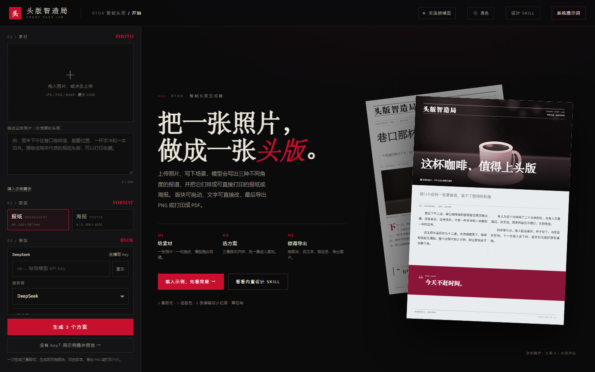

---

## 这是什么

一个网页端的「智能头版」agent：

1. 用户上传一张照片，写一句描述，填入任意 OpenAI 兼容模型的 API Key；
2. 模型按内置的**报纸设计总监提示词 + 设计 Skill**，输出 3 套结构化方案；视觉模板可从 **9 种报纸/海报模板**中按三组风格包切换（经典 / 几何 / 系统）；
3. 前端模板引擎做**确定性渲染**——颜色只能来自预设白名单，版式坐标由模板给出，模型只写内容；
4. 用户并排比较三套方案，选一套进入画布：版块可拖动、可缩放、双击改字，主色 / 栏数 / 字号 / 图片处理实时重排；
5. 画布左下角提供 **20–100% 缩放条**与「适应」；单击板块出现选中框和加粗名称卡片，双击卡片可把该板块**引用到对话**；
6. 编辑器画布在**同源 iframe 沙箱**中渲染，拖动 / 双击 / 导出都在沙箱内完成，父页面只通过 `postMessage` 同步状态；
7. 九套模板都支持「主图 + 子图」双图位：右侧「图片槽位」添加 / 更换 / 移除子图，移除后回到单图且不留占位块；
8. 右侧「对话微调」用一句话改这一版（标题放大、换配色、正文两栏、标题下移），模型返回最小 JSON patch，可撤销；
9. 顶栏一键切换**暗色（原版）/ 亮色（米白 + 电光蓝）**工作室主题，选择会记住；
10. **本地草稿自动保存**：方案、照片、对话和画布位置写入 IndexedDB，刷新恢复；顶栏「草稿」可查看 / 打开 / 删除；
11. 导出 2× PNG，或打印 / 存为 A4 PDF（海报为 4:5）；
12. 顶栏新增 **标准模板 / 设计模式 / 自由模式** 下拉：设计模式使用设计总监提示词，模型可自由选模板、配色、字体和信息量，不套风格包；自由模式在无照片时从 94 枚 24×24 图标库组合 SVG 线条图案。
13. 模型卡片新增 **排版模型 / 生图模型** 用途切换：生图模型按「原图 + 9 种风格」生成或处理素材图，写入素材框后自动切回排版模型生成 3 套版式；生图 Key 独立保存，不复用排版 Key。
14. 导航栏新增 **帮助**：推荐 DeepSeek V4.1 Flash + 火山方舟 Seedream 4.0，附 API 申请步骤、模型填写表、常见错误和官网链接。
15. **三种模式**都会从描述关键词生成 0–3 个英文艺术字装饰（headline / masthead / note），海报优先，字体自动匹配 6 套版式。
16. **Electron 桌面版**：复用同一套网页与本地中继，打包为 Windows 桌面程序，不要求用户单独安装 Node.js。

产物是真实的排版图片，不是聊天窗口里的一段文字。

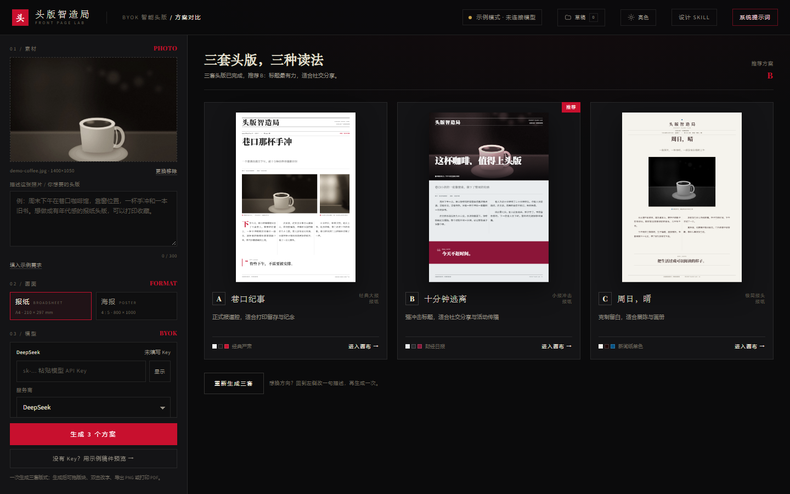

## 快速开始

不需要 `npm install`，运行时依赖已经 vendor 到 `public/vendor/`：

```bash
node server.mjs
# → http://127.0.0.1:5173
```

要求 Node 18+（推荐 20+，使用全局 `fetch`）。

打开页面后：

- 点 **「载入示例，先看效果」**，用内置示例稿件直接体验完整流程（不需要 Key）；
- 或上传照片、填写描述、配置模型 Key，点 **「生成 3 个方案」**。

### 一键启动（Windows）

解压后双击项目根目录的 **`启动项目.bat`**（实际逻辑在 `start.bat`，`启动项目.bat` 是对应的中文入口）：

- 自动检查 Node.js；
- 检测 5173 端口是否已有服务；
- 启动本地服务，并在 2 秒后打开浏览器；
- 启动窗口需要保持打开，**关闭窗口即停止服务**；
- 再次双击只会打开浏览器，不会重复启动；
- 加 `nobrowser` 参数可只启动服务、不打开浏览器（用于测试）；
- 脚本是**可移植**的，不写死项目路径；解压到任意目录都能运行。

兼容入口：`scripts/launch-demo.bat` 会转发到根目录的 `start.bat`。  
更完整的离线说明见 [启动说明.txt](启动说明.txt)。

项目**不需要 `npm install`**：Preact / htm / html2canvas 已 vendor，字体在 `public/fonts/`。

### Electron 桌面版

桌面版复用同一套 `src/`、`public/` 和 `server.mjs`，由 Electron 主进程在启动时拉起一个随机端口的本地服务，再加载网页。  
打包后的桌面程序**不需要用户安装 Node.js**；网页版、Electron 开发态和打包版共用同一份页面逻辑。

开发态：

```bash
npm install
npm run desktop
```

打包：

```bash
npm run desktop:pack      # 生成 dist-desktop/win-unpacked/
npm run desktop:build     # 生成完整桌面目录
npm run desktop:installer # 生成单文件 NSIS 安装包
npm run desktop:portable  # 可选：单文件便携版
```

标准安装包：

```text
dist-desktop/头版智造局-Setup-0.17.1.exe
```

- 单文件 Setup，可自选安装目录；
- 默认按当前用户安装，不要求管理员权限；
- 安装应用文件，并创建桌面快捷方式、开始菜单快捷方式；
- 安装前会强制结束旧的 `FrontPageLab.exe`、旧卸载器和旧版进程，避免覆盖 `Uninstall FrontPageLab.exe` 时文件被占用；
- 快捷方式目标为 `FrontPageLab.exe`，参数为 `--no-sandbox`，避免 Chromium sandbox 初始化失败；
- 安装目录内也保留一个 `启动头版智造局.lnk` 作为兜底；
- 卸载时删除桌面 / 开始菜单快捷方式；
- 用户配置在 `%APPDATA%\FrontPageLab`，卸载默认不删除配置；
- 启动失败日志：`%APPDATA%\FrontPageLab\desktop.log`。

开发 / 解包运行：

```bash
npm install
npm run desktop
```

- 窗口默认 1440×900，最小 1100×720；
- 应用只监听 `127.0.0.1`，不暴露局域网；
- 外部帮助链接用系统浏览器打开，应用内不允许跳转到外部页面；
- 桌面版关闭窗口即停止内嵌服务。

> 安装包目前未做代码签名，Windows SmartScreen 可能提示“未知发布者”；选择“仍要运行”即可。

也可以直接用 URL 进入某个状态（方便演示 / 截图）：

```
http://127.0.0.1:5173/?demo=1                      # 示例稿件 → 三套方案
http://127.0.0.1:5173/?demo=1&scheme=B             # 直接打开方案 B 画布
http://127.0.0.1:5173/?demo=1&scheme=B&format=poster  # 海报模式
http://127.0.0.1:5173/?theme=light                 # 亮色主题
http://127.0.0.1:5173/?demo=1&theme=light          # 亮色 + 示例
```

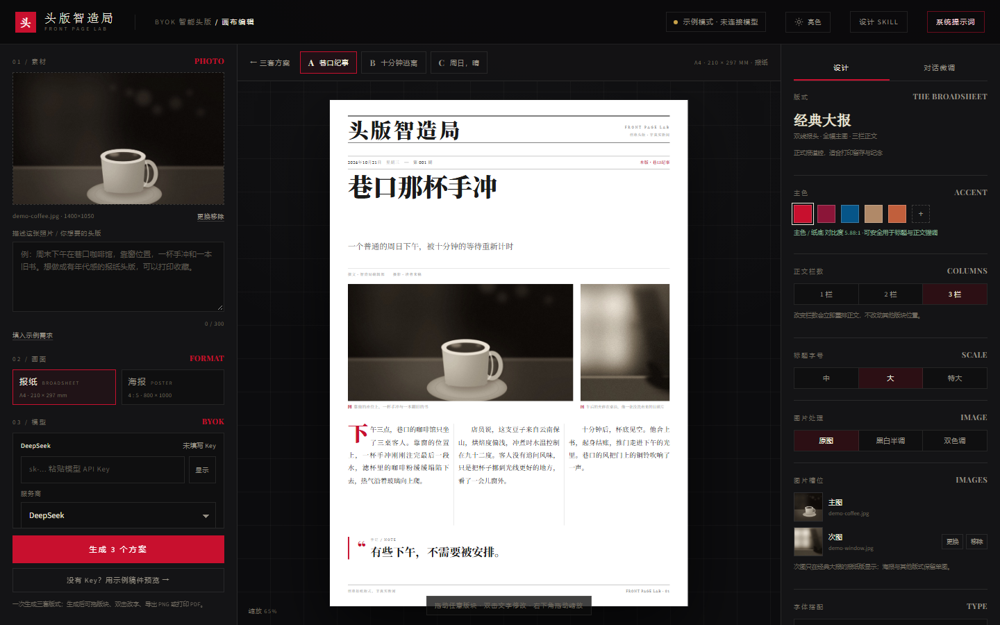

## 帮助：推荐模型与 API 申请

导航栏右上角的 **「? 帮助」** 提供推荐模型和申请指引：

| 用途 | 推荐模型 | 平台 |
|---|---|---|
| 排版 | **DeepSeek V4.1 Flash** | DeepSeek 开放平台 |
| 生图 | **Seedream 4.0** | 火山引擎 · 火山方舟 |

弹窗内包含：

- 两个平台的注册、实名、创建 API Key、开通模型步骤；
- 应用内 Base URL / 模型 / Key 的填写表；
- 401 / 403 / 404 与「生图模型不存在」的排查；
- 官方链接：开放平台、API Key 管理、API 文档、火山方舟图片生成 API、Seedream 4.0 模型页；
- 免费额度提示：两个平台对新用户有免费额度，具体额度和有效期以官网活动页 / 控制台为准。

> 火山方舟图片请使用 **Seedream**；**Seedance 是视频模型**，不返回图片。

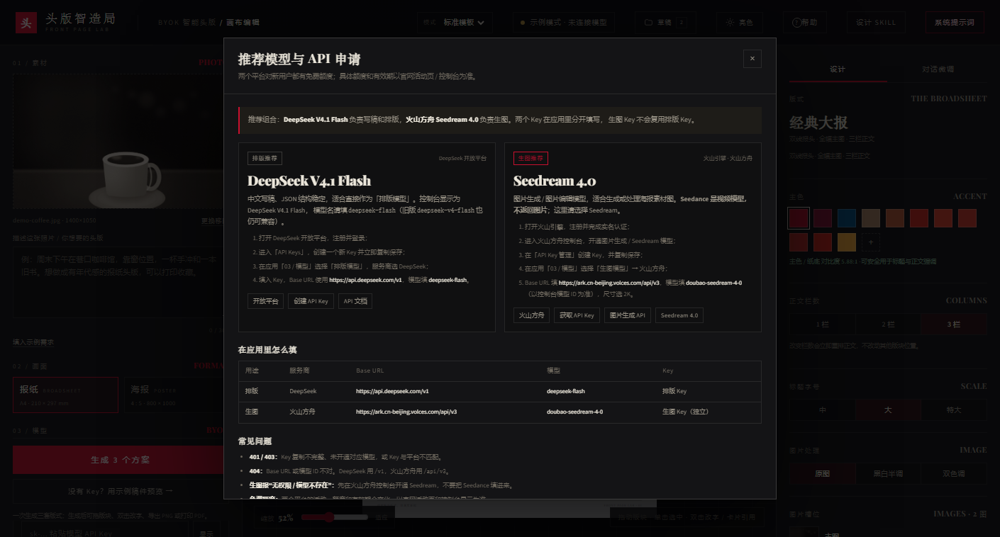

## 艺术英文字体（三种模式 / 海报优先）

标准模板、设计模式、自由模式都会从用户描述 / 照片中提取关键词，生成 **0–3 个英文艺术字装饰**。海报优先使用 2–3 个，报纸最多 1 个（headline）。它只用于英文，不替换中文标题。

| 版式 | `style.art_font` | 字体 |
|---|---|---|
| 构成主义 | `constructivism` | FPL Constructivism |
| 包豪斯 | `bauhaus` | FPL Bauhaus |
| NASA 朋克 | `nasa_punk` | FPL Nasa |
| 风格派 | `de_stijl` | FPL Stencil |
| 瑞士风格 | `swiss_style` | FPL Swiss |
| 卡带未来 | `cassette_futurism` | FPL Cassette |

`content.art_words` 的格式：

```json
[
  { "text": "SLOW MORNING", "placement": "headline" },
  { "text": "WINDOW SEAT", "placement": "masthead" },
  { "text": "ISSUE 03", "placement": "note" }
]
```

- `headline`：中文主标题上方的 kicker；
- `masthead`：报头右侧小标签；
- `note`：海报注记上方短标签；
- masthead / note 只在海报格式显示，headline 在报纸和海报都显示。

规则：

- 英文 1–4 个词、≤32 字符，只允许英文字母 / 数字 / 基本标点；
- 关键词必须来自用户描述或照片内容，不写成中文标题的逐字翻译；
- 字体自动匹配版式；经典大报 / 小报冲击 / 极简报头没有专属艺术字，会回退为标题字体；
- 中文 `headline` 仍使用原来的 `font_pairing`，不会被艺术字影响；
- 前端会清洗非 ASCII 字符、限制位置数量和文本长度，不生成品牌名、真实机构或英文假新闻；
- 装饰数量克制，不能让英文盖过中文标题。

字体文件在 `public/fonts/`，通过 `@font-face` 加载；导出前会等待 `document.fonts.ready`。

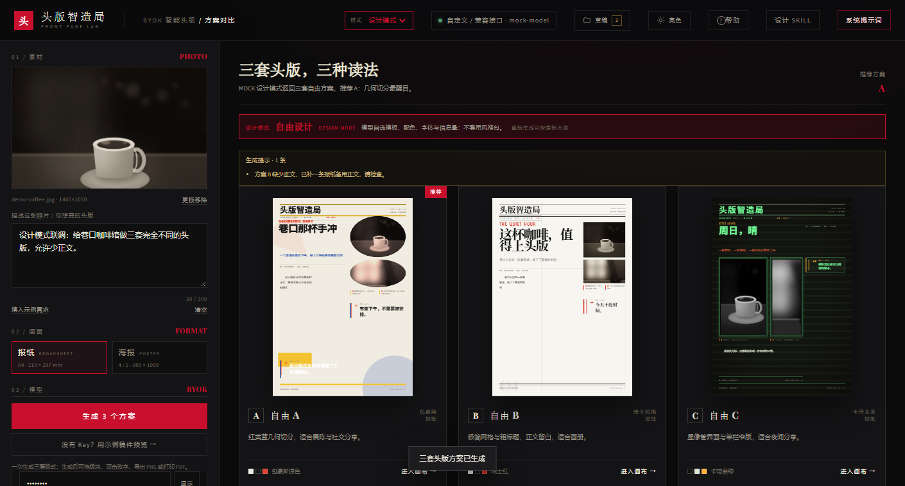

海报 headline / masthead / note 三处装饰：

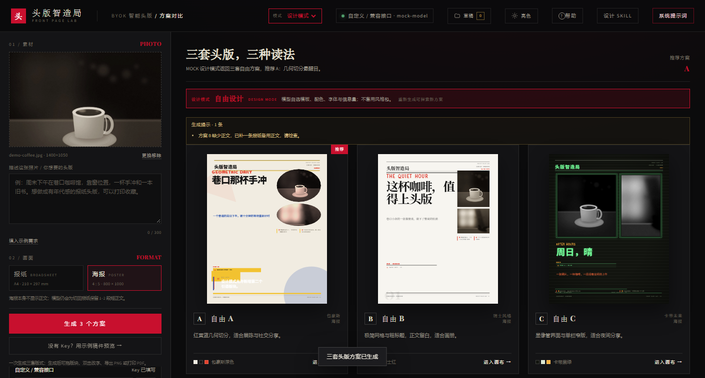

## 接入真实模型（BYOK）

左侧「03 / 模型」里填写：

| 字段 | 说明 |
|---|---|
| 模型用途 | 排版模型 / 生图模型；两套配置分别保存 |
| API Key | 排版 Key，只存 `sessionStorage` |
| 生图 Key | 独立保存；留空不会复用排版 Key |
| 服务商 | 排版：DeepSeek / OpenAI / Moonshot / 智谱 / SiliconFlow / 自定义；生图：火山方舟 / OpenAI Images / 自定义 |
| Base URL | OpenAI 兼容地址，如 `https://api.deepseek.com/v1` |
| 模型名 | 如 `deepseek-flash`、`gpt-4o-mini`、`doubao-seedream-4-0` |
| 请求方式 | `自动`：本地开发走中继，静态部署走直连；也可手动切换 |
| 让模型直接看图 | 仅排版视觉模型可用；不勾选时模型只根据文字描述写稿 |
| 生图参考图 | 模型支持时才走参考图编辑 / 图生图 |

本地中继：

- `POST /api/llm` 转发对话请求；
- `POST /api/image` 转发图片生成 / 图片编辑请求；
- 两者都**不落盘、不记录 Key**，并拒绝非 https、本机地址。生产部署可改为直连或自己加一层 Serverless 中继。

> 如果你不是用 `node server.mjs` 启动，而是用任意静态服务器打开本项目，请把「请求方式」改成
> **浏览器直连**——那种情况下没有本地中继，需要模型服务商允许浏览器 CORS。

DeepSeek 示例配置：

```
服务商：DeepSeek
Base URL：https://api.deepseek.com/v1
模型名：deepseek-chat
```

> DeepSeek 的对话模型不接收图片，勾选「让模型直接看图」会失败；需要读图时换 OpenAI / 智谱视觉模型。

## 三套方案、九种模板与风格包

模型被要求输出三套**角度不同**的稿子（正式纪念 / 社交传播 / 克制动人），前端再用模板渲染。下表是「经典三式」风格包的默认组合：

| 方案 | 版式 | 配色 | 特征 | 适合 |
|---|---|---|---|---|
| A | `classic_broadsheet` 经典大报 | `classic_serious` 经典严肃 | 双线报头、**主图 + 次图双图位**、三栏正文、红色首字 | 打印留存 / 纪念 |
| B | `tabloid_bold` 小报冲击 | `financial_daily` 财经日报 | 满版压图标题、强调色横幅、双栏 | 社交分享 / 活动 |
| C | `minimal_masthead` 极简报头 | `newsprint_single_accent` 新闻纸单色 | 居中窄图、细线分区、大留白 | 展陈 / 画册 |

目前共 **9 种模板 / 3 组风格包**，一次仍然只显示 3 套：

| 风格包 | 三种模板 | 关键词 |
|---|---|---|
| 经典三式 | 经典大报 · 小报冲击 · 极简报头 | 正式、冲击、留白 |
| 几何三式 | 构成主义 · 包豪斯 · 风格派 | 斜切红黑、红黄蓝积木、粗黑线分格 |
| 系统三式 | NASA 朋克 · 瑞士风格 · 卡带未来 | 硬件面板、模块网格、黑底显像管 |

- 六个新风格按《六种经典设计风格提示词》整理：构成主义 / 包豪斯 / NASA 朋克 / 风格派 / 瑞士风格 / 卡带未来；
- 每个模板都有**报纸 + 海报两套坐标**、独立配色、字体和 CSS 装饰；
- 生成仍只出 3 套；画廊顶部的「换一组」或底部「再换三种风格」会切到下一包，**保留三套稿子的内容**，只重排版式、配色和字体；
- 生成时模型只负责 A/B/C 三种内容角度，视觉层由当前风格包覆盖；
- 换风格包会重排模板并恢复该包默认色 / 字体，**之前手动拖过的位置、改过的颜色会被重置**；建议在进入画布前先选好风格包。

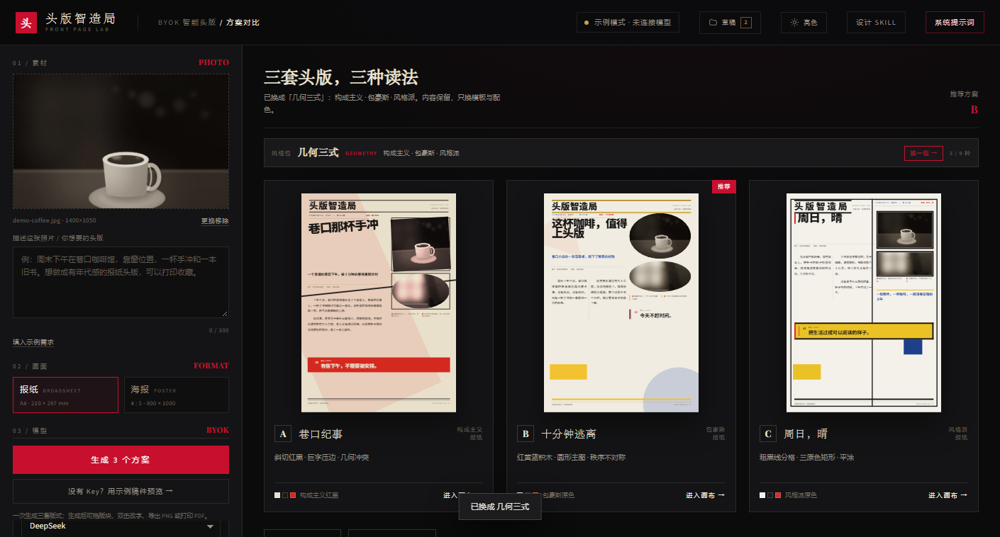

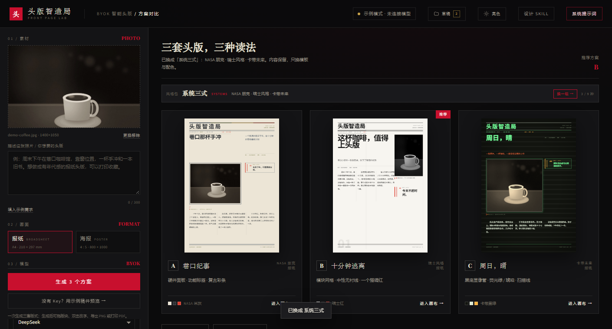

同一套内容可在**报纸（A4 210×297）**与**海报（4:5 800×1000）**之间切换，两套版式坐标独立保存：

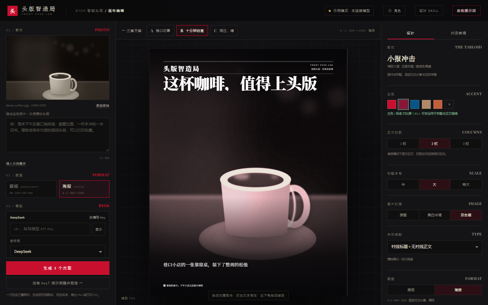

### 标准模板 / 设计模式

顶栏新增模式下拉，默认「标准模板」，可切换「设计模式」：

| | 标准模板 | 设计模式 | 自由模式 |
|---|---|---|---|
| 提示词 | 固定 A/B/C 三种内容角度 | 设计总监提示词，按场景独立判断 | 设计总监 + 自由图案提示词 |
| 模板 | 风格包决定三套模板 | 模型从 9 套模板中自由选择 | 模型从 9 套模板中自由选择 |
| 配色 / 字体 | 跟风格包 | 模型从白名单中自由选择 | 模型从白名单中自由选择 |
| 三套差异 | 前端强制模板 / 配色不重复 | 允许同模板 / 同配色，强调设计逻辑差异 | 同设计模式 |
| 正文 | 2–4 段、至少 120 字 | 1–4 段；海报仍写 1–2 段短正文，供切回报纸 | 同设计模式 |
| 板块 | 模板固定，只能拖动 | 可增删板块、改绝对坐标、移出模板骨架 | 同设计模式 |
| 图像 | 用户照片 / 占位 | 用户照片 / 占位 | **有照片用照片；无照片生成 SVG** |
| 风格包 | 画廊顶部可切换 | 隐藏，不覆盖模型选择 | 隐藏 |
| 对话 | 最小 patch、版式骨架不动 | 可换模板、增删板块、绝对坐标、互换占位矩形 | 同设计模式 |

设计模式仍然保留技术边界：3 套、JSON Schema、模板 / 配色 / 字体白名单、无虚构图片或事实；坐标可以自定义，但必须留在纸张安全范围内。

设计提示词改编自《头版智造局_设计提示词.md》，按 demo 的实际 JSON 接口收敛了变量、模板能力和字段；生成时由模型自由选择 9 套模板中的任意一套，不再强制 A/B/C 对应固定风格。

模式会写入 `localStorage`，刷新后保留；切换模式只影响下一次生成 / 对话，不强制改写当前三套稿子。

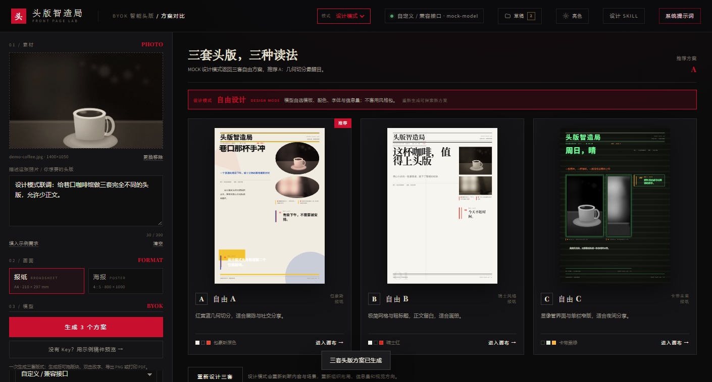

#### 设计模式的版式自定义

- **新增板块**：生成时 `extra_blocks` 可新增报头、日期栏、主标题、副标题、署名、图注、正文、引语、海报注记、页脚；对话里也可以继续加。新增板块的文字可双击编辑，随草稿保存；
- **同类型编号**：同类型板块超过一个时，画布选中卡片会显示「主标题 1 / 主标题 2」「页脚 1 / 页脚 2」等编号，对话引用也使用带编号的名称；
- **类型不能混用**：页脚必须用 `footer`，报头 / 日期栏 / 署名也各有类型，不能用 `note` 代替；删除某类型最后一个板块后，仍可用 `extra_blocks` 重新新增该类型；
- **绝对坐标**：`layout_overrides`（生成）和 `layout_placements`（对话）用百分比给板块落点，左上角定位；`x + w ≤ 100`、`y + h ≤ 100`，越界会被夹回沙箱；
- **删除板块**：`remove_blocks` 可移除当前模板里不需要的板块，给新层级腾空间；
- **当前格式生效**：自定义版式只作用于生成时的报纸或海报；切到另一种格式时使用模板默认版式；
- **交换板块**：使用 `layout_swaps` 原子交换两个板块的完整占位矩形（x / y / w / h），不会再出现两个相对位移互相压住的问题；
- **重叠保护**：对话里的普通位移 / 绝对落点如果产生**新的**重叠，会回退冲突移动并提示；模板里原本有意的小报标题压图不会被误伤。

> 之前的定位逻辑确实是左上角 x / y + 宽高；用两个相对位移模拟“互换”时，大板块会在中途穿过对方。现在交换用完整矩形，落点用绝对坐标，并加了新重叠回退。

#### 自由模式：无图生成 SVG 图案

顶栏第三个模式是「自由模式」，选择时先弹提示：

> **推荐使用支持 SVG / 图像生成的结构化模型**

确认后才切换；取消保持原模式。

- **不需要参考图**：每套方案生成 1 个主视觉 SVG，仍保留 3 套 A/B/C 与 9 套模板结构；
- **有照片就用照片**：上传照片后自由模式直接使用照片，不调用图案生成；移除照片后回到已生成的 SVG / 兜底图案；
- **和设计模式一样自由**：模板、配色、字体、正文量、增删板块、绝对坐标、互换都保留；
- **图标库优先**：模型不再从零画 SVG，而是从 **94 枚 24×24 图标**中选 1–3 个 symbol，前端负责构图和样式；
- **主图案放大**：每套构图的第一枚 symbol 是主图案，中心构图约放大 75%，duo / triad 等组合约放大 60–90%，副图案保持小尺寸，画面不再空；
- **九套模板配方**：线宽、填充、偏移阴影、透明度按模板固定，颜色由 palette token 注入；
- **模型加元素**：模型可追加最多 8 个简单 `line / circle / dot / rect / arc / path` 元素；
- **两阶段生成**：先写内容与版式，再单独生成图案方案；图案失败不影响文案，逐套回退；
- **SVG 安全**：只允许简单线条 / 几何元素；填充仅 palette + 低透明度；禁止 script、foreignObject、image、text、filter、渐变和外链；单图 ≤12KB；
- **象征表**：偶像 → 荧光棒，日本 → 樱花，DeepSeek → 鲸尾，AI → 芯片/机器人，咖啡 → 杯子，城市 → 天际线，旅行 → 飞机，时间 → 表盘；
- **导出**：预览用 SVG，导出前在父页面光栅化成 PNG，避免 html2canvas 1.4 解码 SVG 失败。

图标库与修正后的鱼 / 星星 / 彩虹：

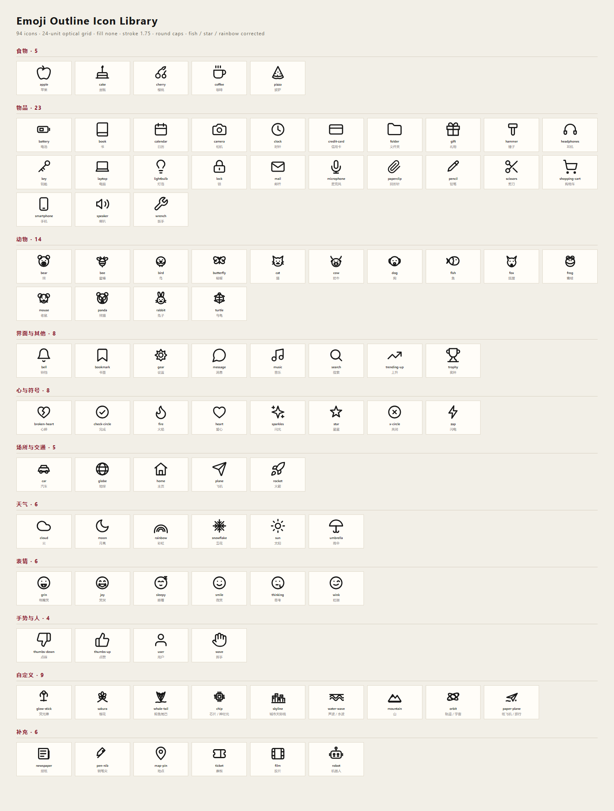

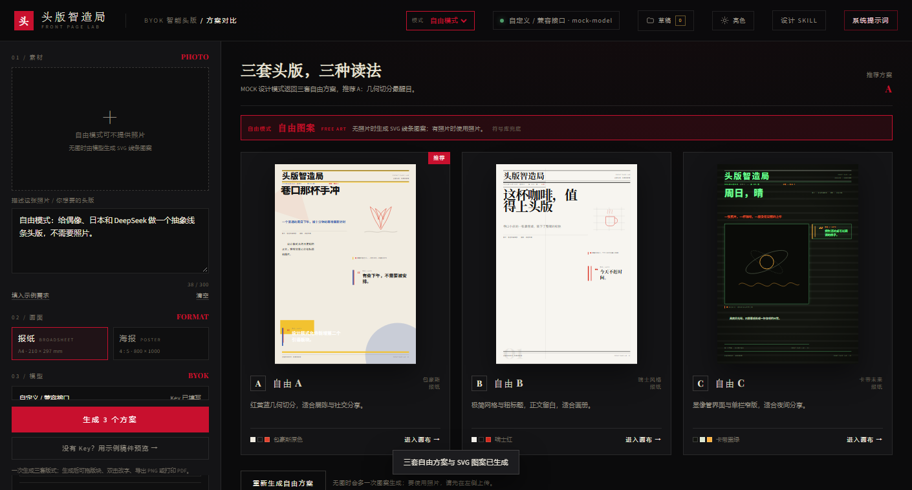

### 生图模型 + 排版模型（双阶段）

左侧「03 / 模型」新增 **模型用途**：

- **排版模型**：写稿 + 设计版式，保持原有流程；
- **生图模型**：先生成或处理素材图，成功后自动切回排版模型。

生图模式：

- 提示词 textarea 缩短到 2 行；
- 出现「视觉风格」下拉：**原图 + 9 种已有模板风格**（经典大报 / 小报冲击 / 极简报头 / 构成主义 / 包豪斯 / NASA 朋克 / 风格派 / 瑞士风格 / 卡带未来）；
- 支持 **无参考图文生图**，也支持 **参考图编辑 / 图生图**；
- 生成结果写入素材框，显示「AI 素材 · 风格名」，可 **恢复原图**；
- 成功后自动切回排版模型；默认自动生成 3 套版式，可取消「生成素材后立即排版」改为手动生成。

生图 Key 独立保存：

- 只写入本标签页的 `sessionStorage`；
- 留空不会复用排版 Key，而是直接提示填写生图 Key。

服务商：

- 内置 **火山方舟 / OpenAI Images / 自定义兼容接口**；
- 第一版走 OpenAI 兼容的 `/images/generations`，参考图在 OpenAI 下走 `/images/edits`，火山方舟走图片生成接口的 `image` 参数；
- 火山方舟图片模型请使用 **Seedream**；**Seedance 是视频生成模型**，不返回图片，不能作为本流程的生图模型。

火山方舟示例：

```text
Base URL：https://ark.cn-beijing.volces.com/api/v3
模型名：doubao-seedream-4-0
尺寸：2K
```

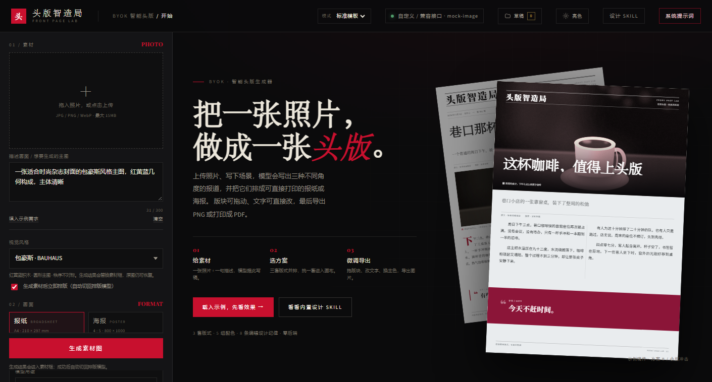

### 多图模式（所有模板）

- **九套模板全部支持主图 + 子图**；`buildLayout(variant, format, hasSub)` 会把主图位拆成两张图，窄图位会自动改为上下叠放；
- 不同模板使用不同的子图形状：经典大报竖构图、包豪斯圆形、构成主义斜切、NASA 面板、卡带显像管边框等；位置比例也按模板调整；
- 右侧「图片槽位」可以 **添加子图 / 更换 / 移除**；移除后版式立即回到单图，**不留占位块**，主图自动吃满原区域；
- 每张图有独立图注：主图 `caption`，子图 `caption_secondary`；
- 点「生成补充文案并重排」会让模型读当前标题 / 正文和两张图，分别写主图 / 子图图注，然后按双图版式重排（视觉模型会直接读图；文本模型写中性描述）；
- 只有一张照片时使用单图全宽版式；模型不再被要求生成子图占位对象。

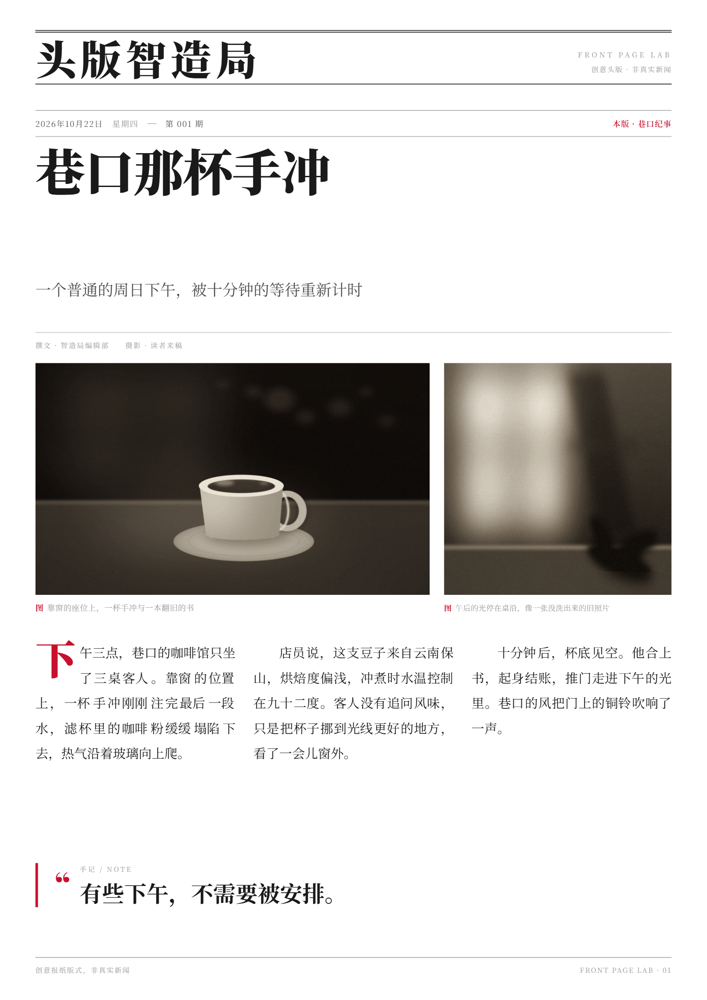

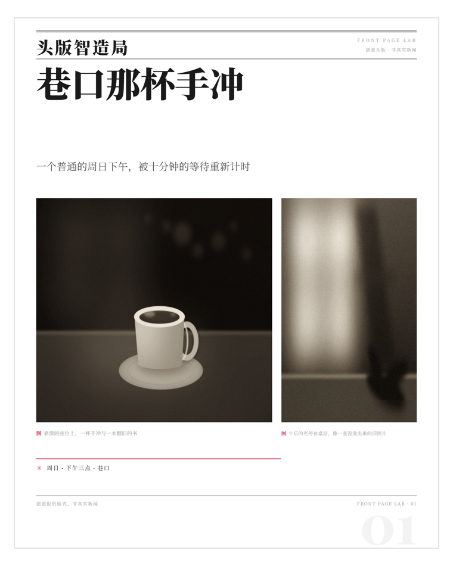

### 海报留白与装饰

- 海报不展示完整正文，容易留白；生成提示词允许模型写一条 `poster_note`（≤30 字：时间、地点、版次、氛围短句或英文小标签）；
- 九个海报模板都预留了注记位，并按模板做字号、边框、底色、等宽字体等不同处理；
- 模板本身也增加了静态装饰：经典大报的 ghost 期号、NASA 的彩条与技术角标、风格派的色块、包豪斯的几何形、瑞士的 01、卡带的扫描线与状态标签；
- 只允许短装饰文案，不允许用长段落硬填，也不允许编造真实事件或机构。

颜色、字体、版式全部来自 `src/config/presets.js`（移植自 `newspaper-design-presets.json`）。模型不输出任何 hex 色值，越界会被前端硬校验回退。

## 内置提示词与设计 Skill

- `src/agent/systemPrompt.js`：角色、能力边界、写作流程、反俗套清单、白名单、JSON Schema、自检项；
- `src/agent/designPrompt.js`：设计模式的生成 / 对话提示词，允许自由选模板、配色、字体与信息量；
- `src/agent/artPrompt.js`：自由模式的 SVG 图案提示词（符号表、线条约束、调色 token）；
- `src/agent/artwork.js`：模型图案规范化、符号库兜底、导出 PNG 光栅化；
- `src/agent/designSkill.js`：蒸馏自 `garden-skills/web-design-engineer` 的设计纪律（阅读顺序、网格留白、字体层级、色彩纪律、印刷工艺、反 AI 味），随系统提示词一起发送；
- `src/agent/chat.js`：对话微调的专用提示词 + `patch` 白名单 / 应用 / 夹紧，与生成提示词分开；
- 页面右上角 **「设计 SKILL」/「系统提示词」** 可以看到全文，方便调参。

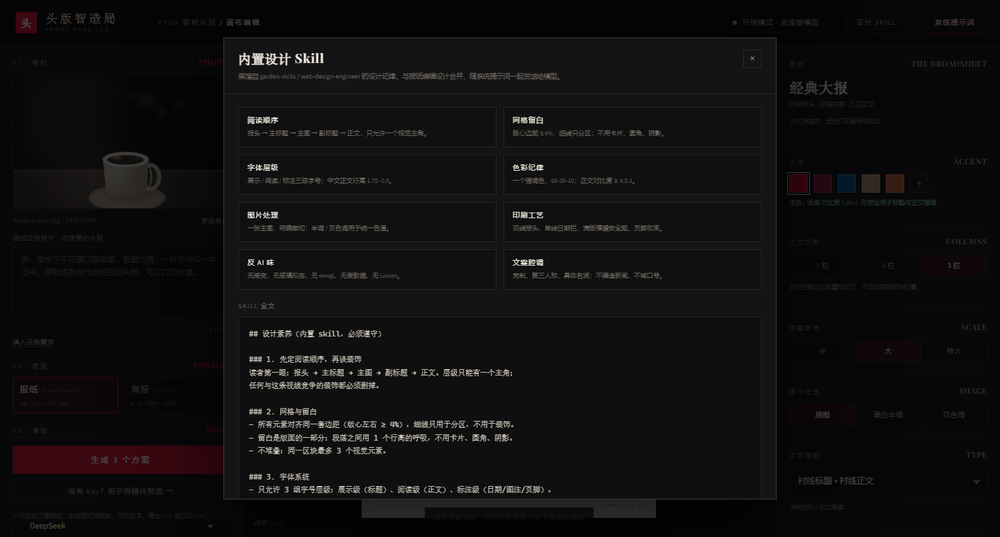

模型只被允许输出这个结构（节选）：

```json
{
  "summary": "…推荐 B…",
  "meta": { "date": "2026年10月20日", "disclaimer": "创意报纸版式，非真实新闻" },
  "schemes": [
    {
      "id": "A",
      "name": "巷口纪事",
      "layout_variant": "classic_broadsheet",
      "color_preset": "classic_serious",
      "font_pairing": "serif_serif",
      "style": { "columns": 3, "headline_scale": "large", "image_treatment": "original" },
      "content": {
        "headline": "巷口那杯手冲",
        "subhead": "…",
        "body_blocks": [{ "type": "paragraph", "text": "…" }],
        "caption": "…",
        "caption_secondary": "子图说明（多图时可选）",
        "poster_note": "海报装饰短句（≤30字）",
        "pullquote": "…",
        "date": "2026年10月20日",
        "image_placeholders": []
      },
      "design_rationale": "正式报道腔，适合打印留存与纪念"
    }
  ]
}
```

前端 `src/agent/validate.js` 做二次硬校验：3 套方案、版式 / 配色 / 字体白名单、标准模式的模板 / 配色去重、标题与正文字数、脚本 / HTML 清洗、颜色从 preset 派生、越界修复并在「生成摘要」中列出警告。设计模式会跳过模板 / 配色去重和正文最低字数；如果正文为空，会补一条报纸备用正文并展示提示，避免海报切回报纸时正文板块空白。

## Prompt 版本备份

提示词改动前先备份到 `prompts/versions/<版本号>/`，目录里保留：

- `systemPrompt.js`：生成提示词 / Schema / 白名单；
- `chat.js`：对话微调提示词；
- `designPrompt.js`：设计模式生成 + 对话提示词；
- `artPrompt.js`：自由模式 SVG 图案提示词；
- `imagePrompt.js`：生图风格提示词（原图 + 9 种）；
- `designSkill.js`：设计 Skill；
- `captions.js`：多图补充图注提示词；
- `manifest.json`：版本、日期、变更说明、对应 Git tag。

当前基线：`v0.5.0`（九套模板完成）、`v0.6.0`（双图 + 海报注记 + 补充图注）、`v0.7.0`（设计模式 + 设计总监提示词）、`v0.8.0`（自定义板块 / 坐标 / 互换与重叠保护）、`v0.9.0`（同类型编号 / 页脚等类型补全）、`v0.10.0`（自由模式 + SVG 图案）、`v0.11.0`（94 图标库 + 组合构图 + 鱼/星/彩虹修正）、`v0.12.0`（海报正文保留与报纸备用正文兜底）、`v0.13.0`（生图模型 + 排版模型双阶段）、`v0.13.1`（帮助与推荐模型指引）、`v0.14.0`（设计 / 自由模式英文艺术字标题）、`v0.14.1`（便携启动脚本与 ZIP 打包）、`v0.15.0`（三模式海报英文艺术字装饰）、`v0.16.0`（Electron 桌面版）、`v0.16.2`（桌面启动兼容与日志）、`v0.17.0`（Windows NSIS 安装包）、`v0.17.1`（安装时强制关闭旧版进程）。新改动不要覆盖旧快照，复制一份新版本再改。[备份说明](prompts/versions/README.md)

## 交互与导出

- **拖动版块**：按住任意版块拖动，带版心参考线和 5% / 中线吸附；显示实时坐标；
- **画布缩放**：左下角 20–100% 滑条 + 「适应」按钮；手动放大超过适应比例后，舞台出现滚动条，纸张不会被裁切；
- **缩放版块**：悬停右下角手柄拖动（图片块会同时改变高度）；
- **双击改字**：标题 / 副标题 / 图注 / 引语 / 正文段落 / 海报注记均可直接编辑，`Esc` 取消，`⌘/Ctrl+Enter` 提交；
- **板块选中与引用**：单击任意板块出现选中框和加粗名称卡片；双击这张卡片（或按 Alt 双击图片 / 板块）把该板块引用到对话，右侧自动切到对话 tab，输入框上方出现引用 chip，发送时自动带上 `【引用板块：名称（block_id）】`；点画布空白处取消选中；
- **iframe 画布**：编辑器 Paper 渲染在同源 `srcdoc` iframe 内；父页面发送方案 / 缩放 / 主题，iframe 内处理拖动、双击和导出，再通过 `postMessage` 回传。父页面样式不会穿透到纸张（同源 CSS/DOM 隔离，不是安全边界）；
- **Tweak 控件**：主色（含对比度提示）、正文栏数 1/2/3、标题字号三档、图片处理（原图 / 黑白半调 / 双色调）、字体搭配；
- **图片槽位**：主图 / 子图缩略图；可添加、更换、移除子图；移除后自动使用单图版式，**不留占位块**；「生成补充文案并重排」会为主图和子图各写一条图注并重排；
- **对话微调**：右侧 tab，一句话 → 最小 patch，可撤销（见下节）；
- **明暗主题**：顶栏切换暗色原版 / 米白 + 电光蓝，`localStorage` 记忆；
- **导出**：iframe 内 html2canvas 2× PNG，结果经 `postMessage` 回传父页面下载；打印把同一张高清图放进 `@page` A4 / 4:5 的打印窗口；
- 导出前会把半调 / 双色调**烘焙进图片像素**（html2canvas 不渲染 CSS filter），保证预览与导出基本一致；同时临时取消 iframe 内的画布缩放，按 794×1123 / 800×1000 原始尺寸渲染。
  > 注意：html2canvas 1.4 不能解析 `color-mix()` 计算出的 `color(srgb …)`，纸张相关样式不要用 `color-mix`，否则导出会抛 `unsupported color function "color"`；当前纸张样式全部使用 hex / rgba。

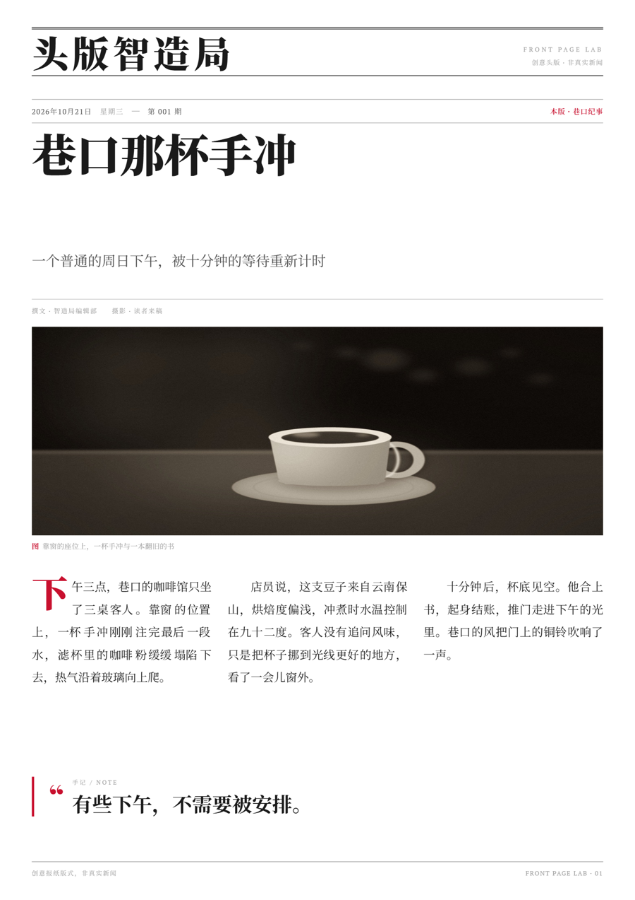

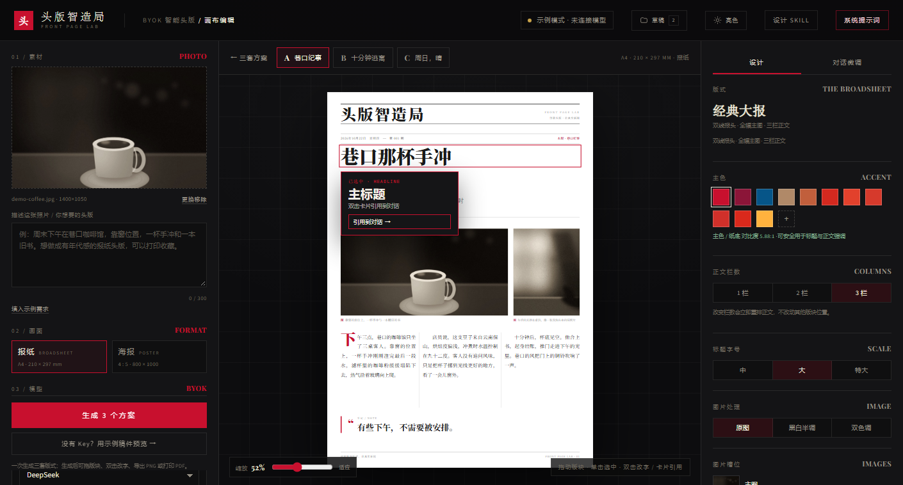

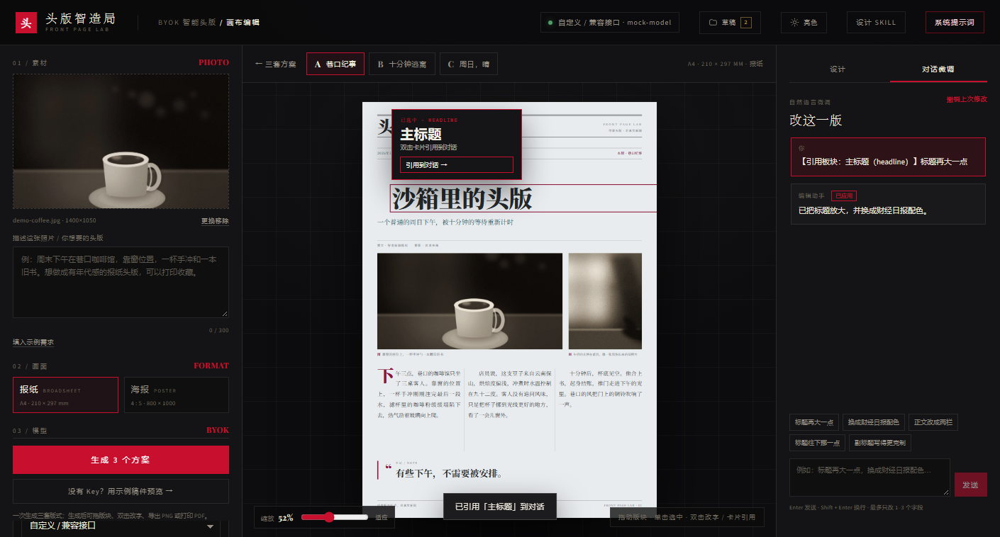

## 明暗主题

- 顶栏「亮色 / 暗色」切换，`localStorage` 记住选择；`?theme=light` / `?theme=dark` 可直接进入。
- 暗色：原来的黑红工作室；亮色：米白纸感 + 电光蓝 `#4D6BFE` 的 DeepSeek 主题。
- 主题只改工作室外壳（导航、输入、画布背景、检查器、弹窗、聊天），**不改报纸/海报自身的 `color_preset`**——导出的图片仍然是方案本身的配色。
- 首次加载时在 `index.html` 的内联脚本里先写 `data-theme`，避免闪白 / 闪黑。

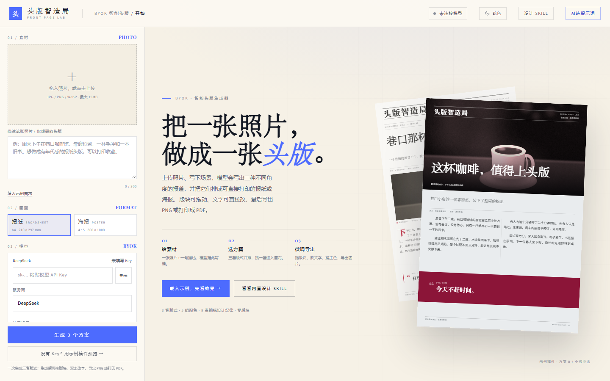

## 对话微调（Phase 3）

右侧检查器的「对话微调」tab：用一句话改当前这一版。


- 输入指令（或点快捷 chips）→ 模型读取**当前方案 JSON + 当前画布坐标 + 最近 4 句对话**，返回 `{ reply, patch }`；
- patch 只能落在白名单：`color_preset` / `font_pairing` / `style.columns|headline_scale|image_treatment` / `content.*` / `layout_moves`（dx / dy ±12、dw ±15 个百分点）；
- 前端 `applyChatPatch` 做夹紧与清洗：版式骨架、照片、日期、块数量都不能改；越界坐标会被 clamp；
- 「撤销上次修改」保留每个方案最近 10 次对话 patch 的快照；
- 没有 Key 时对话输入禁用；对话失败会以红色气泡显示原因，不影响画布；
- 提示词独立在 `src/agent/chat.js`，与生成提示词分开，便于单独调。

> 对话记录会随草稿保存，打开草稿后 ChatPanel 会恢复消息；但发给模型的上下文仍然只带最近 4 句（不做长期记忆）。要整版重构，回左侧重新生成更稳。

## 本地草稿 / 对话历史

- **自动保存**：800ms 防抖，把 `schemes / photo / photo2 / chats / view / active / format / meta` 写入 IndexedDB；
- **刷新恢复**：`localStorage` 只存当前草稿 id，启动时读取草稿并恢复到画廊 / 画布；
- **草稿列表**：顶栏「草稿 N」→ 打开 / 删除 / 新建；当前草稿有「当前」标记；
- 照片以 data URL 存 IndexedDB；**API Key 不写入草稿**，仍在 `sessionStorage`；
- 对话历史随草稿保存，恢复后能看到之前的指令与回复；
- 浏览器禁用 IndexedDB 或配额不足时会提示保存失败，但不影响当前编辑。

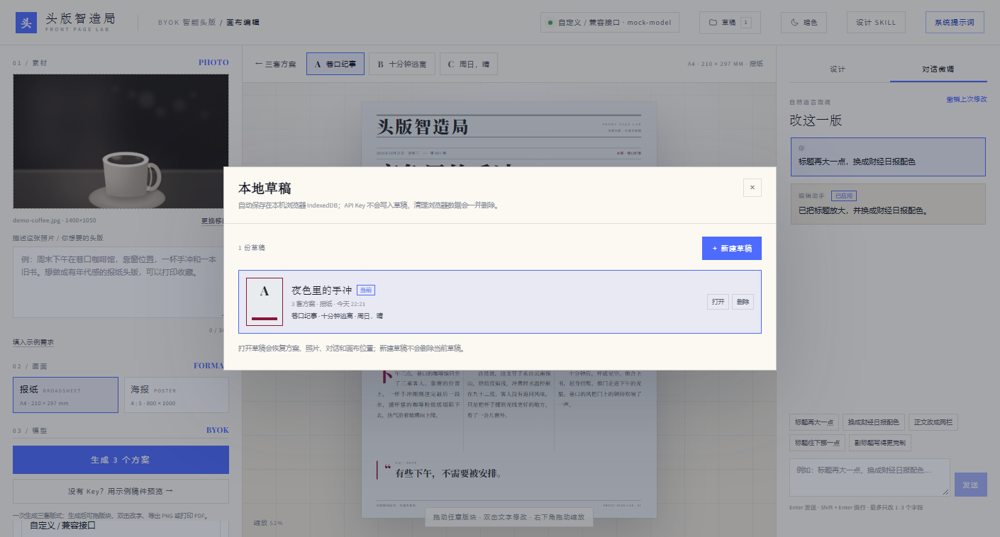

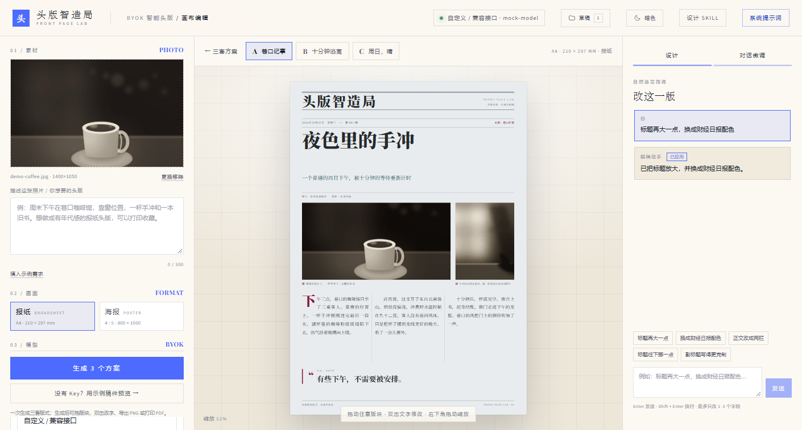

## 架构

```
index.html (import map + vendored Preact/htm/html2canvas + theme 预置)
  └─ src/App.js                 状态机：intro → gallery → editor；主题 / 对话 / 草稿 / 自动保存
       ├─ components/InputRail  素材 / 格式 / BYOK / 生成
       ├─ components/Gallery    三套方案并排 + 风格包切换
       ├─ components/Editor     画布 + 缩放条 + 方案 tab
       ├─ components/IframePaper iframe 沙箱宿主：状态发送 / 选中引用 / 事件接收 / 导出请求
       ├─ components/Paper      模板引擎：blocks → 报纸/海报 DOM（预览 + iframe 内）
       ├─ components/Inspector  设计 tab / 对话 tab + 图片槽位（增删子图 / 补充图注） + 导出 + JSON
       ├─ components/ChatPanel  对话消息 / 快捷指令 / 引用 chip / 撤销
       ├─ components/DraftsModal 草稿列表 / 打开 / 删除 / 新建
       └─ components/Modals     Skill / Prompt / JSON 查看
  └─ sandbox/entry.js           iframe 内入口：渲染 Paper、拖动/改字、选中卡片、html2canvas 导出
  └─ agent/
       ├─ systemPrompt.js       标准模式提示词 + Schema + 白名单
       ├─ designPrompt.js       设计模式提示词（生成 + 对话）
       ├─ artPrompt.js          自由模式 SVG 图案提示词
       ├─ artwork.js            图案规范化 / 符号兜底 / 导出光栅化
       ├─ designSkill.js        内置设计 Skill
       ├─ chat.js               对话微调提示词 + patch 校验 / 应用
       ├─ captions.js           多图补充图注提示词
       ├─ llm.js                OpenAI 兼容请求、JSON 提取、错误翻译
       ├─ validate.js           硬校验 / 修复 / 布局注入
       └─ demoData.js           离线示例稿件
  └─ config/presets.js          11 组配色、5 组字体、9 套版式 × 2 格式 + 双图拆分布局
  └─ config/designLayout.js     设计版式：增删板块、绝对坐标、完整矩形互换、重叠回退
  └─ config/icon-library.js     94 枚 24×24 图标库（文档 79 + 自定义 + 补充）
  └─ config/imageStyles.js      生图：原图 + 9 种模板风格提示词
  └─ config/artFonts.js         6 款艺术英文字体与版式映射
  └─ config/symbol-map.js       抽象概念 → 图标象征表
  └─ config/pattern-styles.js   九套模板的线宽 / 填充 / 阴影 / 透明度配方
  └─ config/stylePacks.js       3 组风格包：经典 / 几何 / 系统
  └─ lib/                       image / exportPaper / drafts / svg / composeArtwork
  └─ styles.css / theme-chat.css 工作室外壳 / 9 套模板样式 + 明暗主题 + 对话面板 + 草稿
  └─ prompts/versions/          提示词版本快照（v0.5.0 … v0.15.0）
desktop/main.mjs                Electron 主进程：启动内嵌服务 + BrowserWindow
server.mjs                      静态服务 + /api/llm /api/image 极薄中继（零依赖）
```

**和 Open Design 的对应关系**（按其交互纪律做的垂直化简化）：

| Open Design | 本 demo |
|---|---|
| 多方案画布并排 | 三套版式缩略图并排 |
| 点选深入 | 点卡片进入大画布，顶部 tab 切换 |
| Tweak controls | 主色 / 栏数 / 标题字号 / 图片处理 / 画布缩放 |
| 持续对话 | 右侧「对话微调」：一句话 → 最小 JSON patch → 可撤销；可引用选中板块 |
| 模板库 | 9 套报纸/海报模板，按 3 组风格包轮换；内容保留，视觉重排 |
| iframe 沙箱画布 | 编辑器 Paper 渲染在同源 srcdoc iframe 内；拖动 / 双击 / 导出在沙箱内，`postMessage` 回传；父页面样式不穿透 |
| 确定性导出 | 2× PNG + 打印 PDF |
| BYOK 本地优先 | Key 只存 sessionStorage，中继不落盘 |
| 本地 daemon | 不需要：模型只写 JSON，不碰文件系统 |

**为什么没有让图片生成模型直接排版？** 报纸的可信度来自「可读的文字 + 稳定的版式」，扩散模型画不出可排版的正文。这里让图片模型只负责素材图，LLM 写稿、模板引擎排版、浏览器导出图片——每一步都是确定性的，也才能支持拖动、改字和打印。

## 目录

```
.
├── .github/workflows/ci.yml   # CI：语法检查 + npm test（导出矩阵需本地浏览器）
├── index.html                 # 入口（import map + 字体 + html2canvas）
├── server.mjs                 # 零依赖静态服务 + LLM / 生图中继
├── start.bat                  # 可移植 Windows 启动脚本
├── 启动项目.bat               # 中文入口，转发到 start.bat
├── 启动说明.txt               # 解压后的本地启动说明
├── desktop/
│   ├── main.mjs               # Electron 主进程：内嵌本地服务 + 窗口
│   └── installer.nsh          # NSIS 快捷方式（带 --no-sandbox）
├── src/
│   ├── App.js
│   ├── main.js
│   ├── styles.css             # 工作室外壳 + 报纸模板样式
│   ├── theme-chat.css         # 明暗主题 + 对话面板
│   ├── agent/                 # 提示词 / 校验 / 请求 / 示例 / 对话 patch / 图注 / SVG / 生图
│   ├── components/            # Paper / IframePaper / Inspector / ChatPanel / DraftsModal …
│   ├── sandbox/entry.js       # iframe 内渲染 / 拖动 / 改字 / 选中卡片 / 导出
│   ├── config/presets.js      # 11 组配色 / 5 组字体 / 9 套版式 / 单图与双图布局
│   ├── config/designLayout.js # 设计模式自定义板块、坐标、互换与重叠保护
│   ├── config/icon-library.js # 94 枚 24×24 图标库
│   ├── config/imageStyles.js  # 生图风格提示词
│   ├── config/artFonts.js     # 艺术英文字体映射
│   ├── config/symbol-map.js   # 抽象概念 → 图标象征表
│   ├── config/pattern-styles.js # 九套模板图案配方
│   ├── config/stylePacks.js   # 3 组风格包与包切换
│   └── lib/                   # image / exportPaper / drafts / svg / composeArtwork
├── prompts/versions/          # 提示词版本快照与 manifest
├── public/
│   ├── demo/coffee.jpg        # 程序化生成的示例照片（主图）
│   ├── demo/coffee-2.jpg      # 程序化生成的示例照片（子图）
│   ├── fonts/                 # 6 款艺术英文字体（仅用于英文装饰标题）
│   └── vendor/                # preact / htm / html2canvas（浏览器直接加载）
├── scripts/
│   ├── launch-demo.bat        # Windows 一键启动（桌面 .bat 调用）
│   ├── make_demo_photo.py     # 生成示例主图（Pillow）
│   ├── make_demo_photo_2.py   # 生成示例子图（Pillow）
│   ├── test-validate.mjs      # 校验层单测（含双图布局 / 风格包）
│   ├── test-chat.mjs          # 对话 patch 单测
│   ├── test-free.mjs          # 自由模式 SVG 安全 / 符号兜底单测
│   ├── test-icons.mjs         # 94 图标 / 象征表 / 9 模板 × 6 构图
│   ├── test-image.mjs         # 10 风格 / 生图提示词 / 独立 Key 校验
│   ├── import-icon-library.mjs # 从参考 MD 生成图标库
│   ├── icon-contact-sheet.mjs # 生成 94 图标总览 HTML / PNG
│   ├── check-css.mjs          # 护栏：禁止 html2canvas 不支持的 CSS 颜色函数
│   ├── export-matrix.mjs      # 经典 3 方案 × 2 格式 × 2 主题 导出矩阵
│   ├── mock-llm.mjs           # 本地 mock 模型（生成 + 对话 + 补充图注）
│   ├── cdp-check.mjs          # iframe 隔离：父页面无 .paper / 样式不穿透
│   ├── cdp-sandbox.mjs        # 缩放条 / 选中卡片 / 引用对话 / iframe 拖动 / 导出
│   ├── cdp-styles.mjs         # 3 组风格包轮换 + 六种新风格双图截图
│   ├── cdp-style-export.mjs   # 9 模板 × 报纸/海报导出 18 例（全部双图）
│   ├── cdp-generate.mjs       # 真实点击生成的端到端测试
│   ├── cdp-design.mjs         # 设计模式下拉 / 设计提示词 / 自由模板生成
│   ├── cdp-body.mjs           # 海报空正文 → 切回报纸正文 / 提示 自检
│   ├── cdp-free.mjs           # 自由模式提示 / SVG 图案 / 照片优先 / 导出
│   ├── cdp-image.mjs          # 生图 → 素材框 → 自动切回排版 → 3 套
│   ├── cdp-poster-art.mjs     # 海报 headline / masthead / note 艺术字
│   ├── cdp-chat.mjs           # 对话 patch / 撤销 / 主题切换 自检
│   ├── cdp-export.mjs         # 亮色主题下报纸 / 海报按钮导出 自检
│   ├── cdp-multi.mjs          # 子图增删 / 无占位 / 补充图注 / 单图导出
│   ├── cdp-drafts.mjs         # 自动保存 / 刷新恢复 / 对话历史 / 删除 自检
│   └── cdp-modals.mjs         # 弹窗自检（设计 Skill / 提示词 / JSON / 帮助）
└── docs/                      # README 截图
```

## 自检脚本

```bash
# 1. 单测 + CSS 颜色护栏（无需浏览器）
npm test
# PowerShell 执行策略禁止 npm.ps1 时用：npm.cmd test

# 2. 本地 mock 模型（另开终端）
node scripts/mock-llm.mjs

# 3. 启动 demo
node server.mjs

# 4. 用 Edge/Chrome 无头 + CDP 跑交互 / 生成 / 对话 / 弹窗
#    先启动浏览器：
#    msedge --headless=new --remote-debugging-port=9222 \
#      --user-data-dir=%TEMP%\edge-demo http://127.0.0.1:5173/?demo=1&scheme=B
node scripts/cdp-check.mjs
node scripts/cdp-sandbox.mjs
node scripts/cdp-styles.mjs
node scripts/cdp-style-export.mjs
node scripts/cdp-generate.mjs
node scripts/cdp-design.mjs
node scripts/cdp-body.mjs
node scripts/cdp-free.mjs
node scripts/cdp-image.mjs
node scripts/cdp-poster-art.mjs
node scripts/cdp-chat.mjs
node scripts/cdp-export.mjs
node scripts/cdp-multi.mjs
node scripts/cdp-drafts.mjs
node scripts/cdp-modals.mjs

# 5. 经典导出矩阵：3 方案 × 2 格式 × 2 主题 = 12 例
node scripts/export-matrix.mjs
```

当前自检结果：

- `npm test` 通过（校验 / 对话 patch / CSS 颜色护栏，含 9 模板 / 3 风格包断言）；
- iframe 隔离：父页面不再渲染 `.paper`，iframe 内 12 个版块；父页面注入 `.headline` 样式不穿透，0 异常；
- 画布缩放：52% → 100% → 52%，100% 时舞台 `scrollWidth > clientWidth`，纸张不被裁切；
- 板块选中：单击出现选中框与「主标题」卡片；双击卡片切到对话 tab 并出现引用 chip；发送指令中带 `【引用板块：主标题（headline）】`；
- iframe 交互：沙箱内拖动（left 5→10）、双击改字、换色回渲染；父页面触发导出得到 1588×2246 PNG，0 异常；
- 风格包：经典三式 → 几何三式 → 系统三式 → 回到经典，三套内容摘要保持不变；六种新模板全部进入双图模式，0 异常；
- 九套模板 × 报纸/海报（双图）：**18/18 导出通过**，0 未捕获异常；页脚、斜线、彩条、网格、海报注记都进入 PNG；
- 多图自检：2 图 → 移除子图后回到单图且**无占位块** → 单图导出 → 重新上传 → **补充图注**（主图 / 子图各一条）并重排，0 异常；
- 设计模式自检：顶栏下拉切到设计模式 → 提示词弹窗显示设计总监版 → mock 返回包豪斯 / 瑞士 / 卡带三套不同模板 → 画廊隐藏风格包 → 海报空正文会补报纸备用正文并显示提示 → 三套英文艺术字标题与 FPL Bauhaus / FPL Swiss / FPL Cassette 字体加载 → 切回标准模式恢复风格包，0 异常；
- 自由模式自检：顶栏选自由模式先弹「推荐使用支持 SVG / 图像生成的结构化模型」；取消保持标准、确认后持久化；无照片生成 3 张图标库组合 SVG、无占位；打开画布后 SVG 正常、导出 1588×2246 PNG；上传照片后 3 套改为照片、不显示 SVG，0 异常；
- 海报正文自检：设计模式 + 海报格式生成三套，模型 B 返回空正文 → 画廊显示「缺少正文，已补一条报纸备用正文」→ 进入 B → 切回报纸 → 正文至少 1 段、没有空正文状态；
- Electron 桌面版自检：开发态启动内嵌服务 → 窗口加载 200 → 打包 win-unpacked 启动 200 → 便携版启动 200 → 页面标题 / 模式 / 帮助入口正常，0 异常；
- Windows 安装包自检：Setup 静默安装到指定目录 → 安装目录生成 `FrontPageLab.exe` / 卸载器 / 启动快捷方式 → 快捷方式目标与 `--no-sandbox` 参数正确 → 安装后的程序启动 200；
- 图标库自检：94 枚图标、11 个分组、鱼/星/彩虹修正；9 套模板 × 6 种构图全部通过 SVG 清洗；填充 / 偏移阴影 / 透明度进入组合 SVG；
- 生图自检：切到生图模型 → textarea 从 101px 缩到 78px → 10 个风格选项 → 无图生图 → 素材框显示 AI 素材 → 自动切回排版并生成 3 套；参考图生图 / 原图不调用生图 / 独立生图 Key，0 异常；
- 帮助自检：导航栏「帮助」打开推荐模型弹窗；2 张推荐卡（DeepSeek V4.1 Flash / Seedream 4.0）、7 个官方链接、免费额度与 Seedance 提示均存在，0 异常；
- 海报艺术字自检：设计模式 + 海报生成三套 → headline / masthead / note 各 3 个英文装饰词 → 艺术字体正确加载，0 异常；
- 设计版式自检：mock 方案 A 新增引语板块 `quote2`（左上角 5% / 82%）并覆盖主标题坐标；方案 C 新增 `footer2` 页脚并与原页脚显示为「页脚 1 / 页脚 2」，页脚文字实际渲染；单元测试覆盖新增板块、绝对坐标、完整矩形互换与“新重叠回退”；
- 草稿自检：自动保存 → 刷新恢复方案 + 对话历史 → 新建草稿 → 从列表打开 → 删除，0 异常；
- 经典导出矩阵 **12/12 通过**：暗色、亮色 × 报纸、海报 × 方案 A/B/C，报纸 1588×2246、海报 1600×2000，单例约 1.3–1.9s，**0 未捕获异常**；
- mock 模型端到端生成 3 套方案；对话 patch 应用与撤销通过；明暗主题切换 + `localStorage` 持久化通过；三个弹窗渲染正常。

> `cdp-sandbox` 会写 mock Key 并真的发一条引用对话，`cdp-multi` 会调用 mock 生成补充图注，`cdp-design` 会调用 mock 生成设计模式三套，`cdp-body` 会验证海报空正文兜底，`cdp-free` 会调用 mock 生成 3 张 SVG，`cdp-image` 会调用 mock 图片接口走生图 → 素材 → 排版，`cdp-poster-art` 会验证海报三处艺术字，所以需要先启动 `mock-llm.mjs`；`cdp-check` / `cdp-styles` / `cdp-style-export` 不需要 mock。
> CI 只跑语法检查 + `npm test`；导出矩阵需要本地服务与无头浏览器，放在本地 / 发布前手动跑。
> `check-css.mjs` 会拦住 `color-mix()` / `color()` / `oklch()` 等 html2canvas 无法解析的写法——这正是上次导出失败的根因。

## 第三方与许可

- **Preact**（MIT）、**htm**（Apache-2.0）、**html2canvas**（MIT）已 vendor 到 `public/vendor/`，运行时无需安装；`package.json` 里的依赖仅用于重新拉取 / 升级这些文件。
- 示例照片由 `scripts/make_demo_photo.py` 用 Pillow 程序化生成，不依赖外部图库。
- **94 枚 Emoji Outline 图标**由用户提供的 `emoji-outline-svg-code*.md` 整理；原始参考保存在 `prompts/references/emoji-outline/`，鱼 / 星星 / 彩虹和自定义图标在 `icon-library.overrides.js` 中维护。
- 英文字体 Playfair Display / Source Sans 3 / Source Serif 4 / PT Serif / IBM Plex Mono 为 OFL 许可，通过 Google Fonts **可选、非阻塞**加载；离线时回退到 Georgia / 系统无衬线 / 等宽，中文回退到宋体 / 苹方 / 思源。
- **6 款艺术英文字体**（Alibaba PuHuiTi 构成主义、Bauman 包豪斯、Nasalization NASA、STENCAM 风格派、UNIVERSAL SANS 瑞士、Alphabetized Cassette Tapes 卡带）由用户提供，字体许可与商用范围请以原始字体包为准；本项目只把它们用于英文装饰标题。

## 已知边界 / 下一步

- **默认不生成照片**：图片来自用户上传；可选「生图模型」按风格生成或处理素材图，结果作为排版素材，不参与正文事实；
- **生图依赖外部服务**：当前对接 OpenAI 兼容 `/images/generations` 与 `/images/edits`；火山方舟使用图片生成接口，**Seedance 是视频模型，图片请用 Seedream**；参考图编辑是否可用取决于所选模型；
- **生图 Key 独立**：只存 sessionStorage；留空不会复用排版 Key；生图失败不会覆盖已有素材；
- **没有后端与账号**：项目只存本机 IndexedDB，不存 Key，不做多人协作；
- **对话是短上下文**：每次只带当前方案和最近 4 句，不做长期记忆；要整版重构，重新生成更稳；
- **主题只作用于外壳**：纸张 / 海报的配色仍由 `color_preset` 决定，切主题不会改变导出图片的颜色；
- **拖动是自由拖动**，不是网格约束的 DTP；复杂版面仍建议按预设生成后再微调；
- **字体依赖本机**：中文用宋体 / 苹方 / 思源回退，英文用 Playfair / Source Sans / IBM Plex Mono；Google Fonts 为可选增强（非阻塞加载），离线时会回退；
- **多图范围**：九套模板都支持「主图 + 子图」（最多 2 张）；更多图需要在布局层继续扩展；
- **子图删除即回收**：移除后回到单图全宽版式，不保留占位块；主图图注与子图图注分别保存；
- **海报注记**：`poster_note` 是短装饰文案，不是正文；模型可能输出英文标签或氛围句，均可在画布上双击修改；
- **海报正文会保留**：海报不渲染正文，但生成时仍要求 1–2 段短正文；手动删除正文后，报纸视图会显示「此方案没有正文」的空状态，不再静默空白；
- **艺术字只用于英文**：6 款字体只渲染英文装饰标题，不能用于中文正文；经典 / 小报 / 极简三套没有对应艺术字；字体许可请以原始字体包为准；
- **自由模式仍是线条图案**：每套 1 个主视觉；从 94 枚图标库组合，模型只负责选图案、构图、样式和补元素；不生成写实插画；
- **填充与阴影是受控的**：填充只允许 palette + 低透明度，阴影用偏移重复路径，不使用 SVG filter；
- **纯生图模型未接入**：当前 BYOK 是 chat/completions + 结构化 JSON；DALL·E / Flux / SD 需要单独的 provider 与图片存储，自由模式提示文案已说明这一点；
- **自由模式有照片就用照片**：上传照片后不会同时显示生成的 SVG；移除照片才回到 SVG/兜底图案；
- **设计模式不是无限画布**：仍然只有 9 套基础模板、3 套方案和固定白名单；但支持增删文字板块、绝对坐标和互换。坐标必须落在纸张百分比范围内，且不能新增图片 / scrim / 自定义 HTML；
- **同类型编号是前端行为**：模型只负责给唯一 `id`，数字由渲染层按类型出现顺序生成；删除其中一个后，剩余板块会重新编号；
- **自定义版式只作用于当前格式**：生成报纸时写的坐标不会自动变成海报坐标；切到另一格式看到的是模板默认版式；
- **手动拖动不会写回自定义版式**：对话的坐标 / 互换 / 增删会写回设计版式；手动拖动只改当前布局，换图后可能回到对话保存的版式；
- **切换模式不重写当前稿**：只影响下一次生成 / 对话；从设计模式切回标准模式后，需要重新生成或手动换风格包才会重新套用；
- **风格包会重置微调**：在画廊换风格包会重排版式并恢复默认色 / 字体，之前手动拖过的位置不会保留；建议先选包再进画布；
- **六种新风格是模板化演绎**：按提示词提炼几何、配色、字体和装饰，不是历史原作的精确复刻；
- **iframe 是同源隔离**：用于 CSS / DOM / 选择隔离，不宣称是安全沙箱；跨域嵌入或多实例需要额外 `sandbox` 属性与消息白名单；
- **草稿只在本机**：IndexedDB 按浏览器 / 设备隔离，没有账号同步；清理浏览器数据会删除草稿；
- **移动端**：当前以桌面工作台为主，≤1080px 会隐藏右侧检查器；移动端布局需要单独设计。

下一步优先级：移动端。P0（导出矩阵 + CSS 颜色护栏 + CI）、P1（双图位 + 本地草稿 / 对话历史）、iframe 沙箱、九套模板 / 风格包、双图增删 / 补充图注 / 海报注记、设计模式、自定义板块、自由模式与 94 图标库已完成；提示词快照在 `prompts/versions/`。

---

参考：Open Design 的多方案画布 / Tweak controls / BYOK 交互纪律；garden-skills `web-design-engineer` 的设计素养；`newspaper-design-presets.json` 的配色与字体白名单；六种经典设计风格提示词（构成主义 / 包豪斯 / NASA 朋克 / 风格派 / 瑞士 / 卡带未来）。
