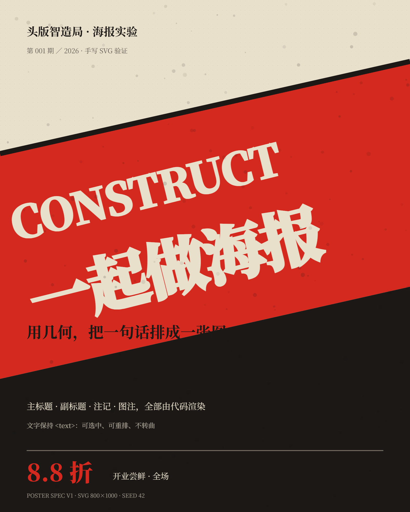
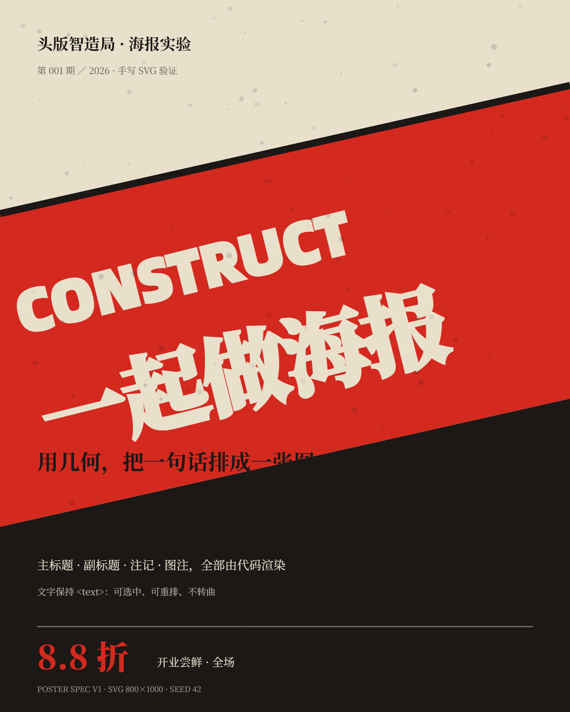

# 海报生成重构方案 · SVG 海报（v1.0 · M4 视觉重做）

> 状态：**M4 已实现**（2026-11-24）；后续可选增强待排期  
> 版本：v1.0（替代 v0.1 评估稿）｜ 日期：2026-11-24  
> 范围：海报（800×1000 / 4:5）生成与渲染链路；报纸链路默认不动  
> 相关：`src/agent/posterSkill.js`、`src/agent/systemPrompt.js`、`src/agent/designPrompt.js`、`src/agent/chat.js`、`src/config/presets.js`、`src/components/Paper.js`、`src/lib/exportPaper.js`、`src/lib/svg.js`

---

## 0.0 实施状态（M4 · 2026-11-24）

**已落地**：

| 项 | 实现 |
|---|---|
| 海报模板 | `src/config/posterTemplates.js`：7 套（新四：干员档案 / 终末信号 / 警戒通告 / 勘测记录；保留三：影像 / 原色 / 斜切）× 2 变体 |
| 图案配方 | `src/config/posterPatterns.js`：11 个配方（含等高线）+ 参数 + seed（替代图标库） |
| 规格与校验 | `src/agent/posterSpec.js`：单套归一化、白名单、参数夹紧、shapes 清洗 |
| 渲染器 | `src/lib/poster/{layout,text,render}.js`：切角主图、单色照片滤镜、巨大空心字、点阵 / 等高线 / 三色条 / 切角画框 / 覆盖层、子图拼贴 |
| 视觉语言 | 近黑 + 青色（方舟档案/新闻）、白纸 + 蓝黄信号（终末地主视觉）、黑黄警戒、暖纸等高线（终末地勘测）；只学结构，不使用官方素材 |
| 生成编排 | `src/agent/posterPrompt.js`、`llm.js#requestPosterScheme`、`App.js`：三路并行、先完成先显示、单套重试；遇 429 标记排队，其余返回后串行重试 |
| 只读画布 | `Paper.js` 海报分支 + `sandbox/entry.js`：不挂拖动 / 双击 / 选中 |
| 检查器 | `Inspector.js`：文案 / 模板 / 变体 / 配色（色板 + 自定义主色 + 对比度）/ 字体 / 字号档 / 配方参数 / seed / 纸纹 / 主图 + 子图 |
| 对话微调 | `chat.js#applyChatPatch`：海报可换模板 / 变体 / 配方 / seed，忽略坐标与 layout_variant |
| 导出 | `src/lib/poster/export.js` + `exportPaper.js#printSvgDocument`：PNG（2×）与矢量 PDF（打印内联 SVG，文字保留 `<text>`）；字体 base64 嵌入 |
| 字体 | `scripts/fetch-web-fonts.mjs`（12 个拉丁 woff2）+ `scripts/subset-fonts.py`（6 款艺术字 latin 子集） |
| 资产版本 | `POSTER_ASSET_VERSION = 4.1.0`，写进 SVG `data-assets` / meta / PNG 文件名 |
| 测试 | `scripts/test-poster-render.mjs`（模板 / 配方 / 文本 / 规格 / 双图 / 确定性 / 提示词 / 资产版本），已挂 `npm test` |

**与上一版的差异**：

- **淘汰瑞士网格与手作志**，新做四套按方舟 / 终末地语言重做，同时恢复影像 / 原色 / 斜切三套；A 档案/信号，B 警戒/原色/斜切，C 勘测/影像。
- 新增渲染能力：切角主图（`heroShape: cut`）、单色照片（`photoFilter: mono`）、巨大空心字（`ghost` + outline）、点阵 / 等高线 / 三色条 / 切角画框 / 前景覆盖层。
- 视觉研究见 `docs/poster-design-research.md`：官方站点只用于提炼结构，不使用官方字体、标志、图标、截图或文案。
- 艺术字：6 款全部 latin 子集；斜切/警戒模板使用 constructivism（2.5MB → 28KB）。
- 双图：模板预留位置的旋转白边小照片拼贴；单图 / 无图自动回退。
- 429：三路先并行，撞上限流的那一路排队，其余返回后串行重试，不整体降速。
- PDF：用浏览器打印内联 SVG（矢量、文字可选），不引入 PDF 库。

**后续可选**：更多方舟/终末地子风格、海报动画、字体许可与云端分发。

---

## 0. 结论与决策

### 0.1 五条已确认决策

| # | 决策 | 对实现的影响 |
|---|---|---|
| D1 | **海报画布只读**，改字/改样式走右侧检查器 | 不做拖动、不做双击覆盖层、不做手绘编辑；检查器工作量从 2–3 天降到 1–1.5 天 |
| D2 | **新做一套海报专用模板** | 海报不再复用 9 套报纸版式；新增 `posterTemplates.js`（7 套 × 2 变体） |
| D3 | **图标库只从海报侧退役**，报纸自由模式保留 | `requestArtworks` 仅报纸调用；海报改配方渲染 |
| D4 | **不提供 SVG 下载**，只出 PNG / PDF | 导出链路简化为「SVG → Canvas → PNG」+ 打印 PDF；不做 SVG 序列化出口 |
| D5 | **先出第一套**（渐进展示） | 海报生成改为 **3 个并行单套请求**，谁先回来先渲染谁；gallery 出占位卡 |

### 0.2 最终架构一句话

**一句话描述 → 模型输出「海报规格」（文案 + 海报模板 id + 图案配方 + 参数 + seed）→ 代码渲染成一张 800×1000 的完整 SVG → 只读画布展示 → 检查器改字/改样式 → 同一张 SVG 导出 PNG / 打印 PDF。**

- 文案、图案、排版都在同一张 SVG 里；
- 文字是 `<text>`（不转曲、可搜索、可选择，只是不允许在画布上直接拖改）；
- 图案来自 10 个「配方 + 参数 + seed」，不再用 94 枚 emoji 图标拼贴；
- 报纸链路（9 套模板 / DOM 渲染 / html2canvas / 图标库）保持不变。

### 0.3 与 v0.1 评估稿的差异

| 项 | v0.1 | v1.0 |
|---|---|---|
| 画布编辑 | S1/S2/S3 待选 | **S3 只读 + 检查器** |
| 海报版式 | 复用 9 套报纸版式 | **海报专用 7 套模板** |
| 图标库 | 海报退役（报纸待定） | **海报退役、报纸保留** |
| 导出 | PNG/PDF + 可选 SVG | **仅 PNG/PDF** |
| 生成调用 | 建议不拆 | **拆成 3 路并行单套**（为了先出第一套） |
| 渲染链路 | 建议拆 | 确认拆（海报 SVG / 报纸 DOM） |

---

## 1. 现状与硬约束

### 1.1 现在的海报链路

```text
描述 + 照片(可选)
  → 1 次 /chat/completions（3 套 scheme，JSON，max_tokens 3200，120s）
  → normalizeSchemes 硬修
  → 【自由模式且无照片】第 2 次请求（max_tokens 6000）生成 3 个图标组合
  → composeArtwork + sanitizeSvg → 600×450 线条图 data URL
  → Paper 用 DOM 渲染（9 套模板 + 照片 + DOM 文本 + 艺术字）
  → html2canvas 导出
```

海报目前不是一张 SVG：文本是 DOM、图案是 600×450 的 ``、背景装饰是 CSS。

### 1.2 硬约束（决定了不能「模型直出 SVG」）

| 约束 | 现状 | 影响 |
|---|---|---|
| 输出上限 | 生成 3200 / 图案 6000 / 对话 1400 tokens | 一张参考海报 14–102 KB ≈ 4k–29k tokens，最小也超限 |
| 输出格式 | 强制 `response_format: json_object` | SVG 塞 JSON 还要转义，+20–40% |
| 超时 | 客户端/服务端 120s | 29k tokens 的 SVG 要 1–5 分钟 |
| SVG 安全层 | `sanitizeSvg` 拒绝 `<text>` / `<image>` / `<style>` / filter / 外链；原文 >16KB 拒 | 整张海报进不了现有安全层 |
| 编辑/导出 | 双击改字、patch、html2canvas 都基于 DOM | SVG 字符串只能当图片 |

### 1.3 为什么不让模型直出 SVG（量化）

| 参考海报 | SVG 体积 | 元素数 | 粗估 tokens |
|---|---|---|---|
| 风格派 | 14 KB | 155 | ≈ 4,000 |
| NASA 朋克 | 60 KB | 614 | ≈ 17,000 |
| 卡带未来 | 102 KB | 1,239 | ≈ 29,000 |

即使拆成「一套一次请求」，单张仍可能 1–4 分钟，且语法错误/字体/换行不可控。**结论：SVG 由代码渲染，模型只出规格。**

### 1.4 耗时构成（含 PS0 实测）

| 阶段 | 现状/实测 | 备注 |
|---|---|---|
| 模型写 3 套稿 | 3–8s | 主要耗时 |
| 自由模式第二次图案请求 | 再 3–10s（串行） | 海报无照片时触发；改造后删除 |
| 本地图案组合 + 清洗 | **0.087 ms/次**（2000 次 175ms） | 可忽略 |
| 整张 SVG 字符串拼接 | M1 再测，预计 <5ms | 可忽略 |
| SVG → PNG（1600×2000） | **71ms（无字体）/ 132ms（嵌字体）** | PS0 实测，见附录 A |
| 导出 PNG 体积 | 1600×2000 ≈ 0.43–0.45 MB | 实测 |

**结论**：海报慢的根因是「多一次串行图案请求 + 模型输出更大」；把 SVG 收回代码后，海报（无照片）比现在快 3–10s。

---

## 2. 目标与不变量

### 2.1 目标

1. 海报由描述直接驱动，输出一张自包含 SVG（文案 / 图案 / 布局），不再依赖 emoji 图标表。
2. **先出第一套**：3 路并行生成，第一张先渲染，其余占位。
3. 海报不再比报纸慢；无照片海报比现在快。
4. 保留：3 套对比、检查器改字/样式、对话 patch、撤销、PNG/PDF 导出、本地草稿。

### 2.2 不变量

| 项 | 要求 |
|---|---|
| 中文清晰 | 文字 `<text>`，不转曲、不进生图模型 |
| 可编辑 | 文案、模板、配色、字体、字号档、图案参数、seed 都能在检查器里改 |
| 可校验 | 模型只选白名单 id + 参数；不吐 hex / SVG / 任意坐标 |
| 确定性 | 同 spec + seed → 同一张 SVG；禁 `Math.random` |
| 安全 | 无外链、无脚本、无 foreignObject；图片只接受本地 data URL |
| 导出 | PNG / PDF 与画布一致 |
| 报纸不降级 | 9 套模板、双图、设计模式、patch 全绿 |

### 2.3 明确放弃

- 海报画布拖动 / 双击改字 / 手绘（D1）；
- 海报使用 94 枚图标库（D3）；
- SVG 文件下载（D4）；
- 模型直出 SVG / path / hex（沿用旧口径）；
- 海报使用 html2canvas（改 SVG → Canvas；报纸仍用 html2canvas）。

---

## 3. 方案选择

| | A. 模型直出 SVG | B. 规格 + 代码渲染（**采用**） | C. 规格 + 小 SVG 美术层 |
|---|---|---|---|
| 可编辑 | 失效 | 检查器可改 | 检查器可改 |
| 校验 | 不可 | 完全可 | 文字/版式可，美术层靠 sanitize |
| token/套 | 4k–29k | 0.8–1.4k | 1.2–2.2k |
| 3 套耗时 | 1–5 分钟 | 5–10s（并行后更快） | 8–20s |
| 结论 | ❌ | ✅ 主链路 | ◐ 预留接口，首版不做 |

C 只在 schema 留 `art.source` 字段位（v1 仅允许 `recipe`），避免以后破坏契约。

---

## 4. 数据契约（PosterSpec v1）

### 4.1 位置

继续用现有 scheme（`layout_variant` / `color_preset` / `font_pairing` / `style` / `content` / `design_rationale`），只加 `poster` 字段：

```json
{
  "id": "A",
  "name": "巷口纪事",
  "layout_variant": "classic_broadsheet",
  "color_preset": "classic_serious",
  "font_pairing": "serif_serif",
  "style": { "headline_scale": "large", "art_font": "none" },
  "content": {
    "headline": "巷口那杯手冲",
    "subhead": "一个普通的周日下午",
    "caption": "靠窗的座位与一杯手冲",
    "poster_note": "周日 · 下午三点 · 巷口",
    "art_words": [{ "text": "SLOW MORNING", "placement": "headline" }],
    "body_blocks": [{ "type": "paragraph", "text": "……60–120 字，供报纸视图……" }],
    "date": "2026年11月24日"
  },
  "poster": {
    "spec_version": 1,
    "template": "poster_ark_file",
    "variant": "quiet",
    "art": {
      "source": "recipe",
      "recipe": "halftone_stars",
      "params": { "density": 4, "stroke": 0.6 },
      "seed": 42,
      "shapes": [{ "kind": "circle", "x": 0.78, "y": 0.18, "r": 0.12, "role": "accent", "opacity": 0.9 }]
    },
    "textures": { "paper": "aged", "grain": 0.18 }
  },
  "design_rationale": "留白较多，用半调星星压刊头"
}
```

`layout_variant` 仍保留报纸版式 id（用于切回报纸时正常渲染）；海报实际用 `poster.template`。两者由归一化函数互相兜底（默认映射表）。

### 4.2 字段契约

| 字段 | 允许值 | 说明 |
|---|---|---|
| `poster.template` | 6 个海报模板 id | 见 §5 |
| `poster.variant` | 每模板 2 个（`quiet` / `loud`） | 只改主角大小与文字位置 |
| `poster.art.source` | `recipe`（v1 唯一） | 预留 `svg_fragment` |
| `poster.art.recipe` | 11 个配方 id | 见 §6.3 |
| `poster.art.params` | 每配方 1–4 个数值，带 `min/max/default` | 越界夹紧 |
| `poster.art.seed` | 0–9999 | 确定性装饰 |
| `poster.art.shapes` | ≤8 个基础几何，坐标 0–1 | **仅背景层**，不参与文字避让 |
| `poster.textures` | `paper` / `grain` 枚举 + 0–0.4 | 合成进 SVG，不用 CSS filter |
| 文案 | 沿用 `contentRules`（headline ≤15 / 建议 ≤9；subhead ≤25；caption ≤30；note ≤30；art_words ≤3） | 防编造规则不变 |

### 4.3 校验（`validatePosterSpec`）

1. `source !== 'recipe'` → 拒绝；
2. 出现 `hex` / `svg` / `path` / `d` 字段 → 拒绝；
3. `recipe`/`template`/`variant` 不在白名单 → 回退默认并 warning；
4. 参数按 `min/max` 夹紧，未知参数丢弃；
5. `shapes` 最多 8 个，坐标 clamp 0–1，越界丢弃；
6. 文案长度/防编造沿用 `validate.js`；
7. 返回 `{ scheme, warnings }`，不抛异常。

> 与旧口径的差异：**背景几何层允许归一化坐标**（不碰文字层），因为背景不参与碰撞检测。

### 4.4 三套角色与模板分配

| 方案 | 内容角度 | 模板 | 图案倾向 |
|---|---|---|---|
| A | 档案秩序 / 可读、有据可查 | `poster_ark_file`、`poster_endfield_signal` | 纸纹、栏网格 |
| B | 警戒冲击 / 短、狠、现场通告 | `poster_ark_hazard`、`poster_primary`、`poster_diagonal` | 斜切、点阵 |
| C | 勘测影像 / 冷静、地点优先 | `poster_endfield_survey`、`poster_kino` | 等高线、纸纹 |

七套模板由三路角度覆盖（A 两套、B 三套、C 两套）；检查器下拉可选全部七套。

---

## 5. 海报专用模板集（7 套 × 2 变体）

### 5.1 清单

| id | 名称 | 构图 | 默认配色 | 默认字体 | 默认配方 | 艺术字 |
|---|---|---|---|---|---|---|
| `poster_ark_file` | 干员档案 | 近黑 + 青色 + 点阵；左侧巨字、右侧切角档案图、底部数据字段 | `ark_night` | `grotesk` | `paper_grain` | `swiss_style` |
| `poster_endfield_signal` | 终末信号 | 白纸 + 蓝黄信号；切角画框、技术注记、三色条 | `endfield_paper` | `grotesk` | `grid_columns` | `swiss_style` |
| `poster_ark_hazard` | 警戒通告 | 黑黄警戒带 + 单色照片 + 压缩巨字 | `ark_hazard` | `grotesk` | `diagonal_split` | `constructivism` |
| `poster_endfield_survey` | 勘测记录 | 暖纸 + 等高线 + 切角照片 + 右侧数据栏 | `endfield_field` | `grotesk` | `contour` | `nasa_punk` |
| `poster_kino` | 影像海报 | 满版主图 + 压字 + 演职员条 | `cassette_dark` | `grotesk` | `paper_grain` | `nasa_punk` |
| `poster_primary` | 原色积木 | 红黄蓝色块 + 圆形主图 + 信息卡 | `bauhaus_primary` | `grotesk` | `dot_matrix` | `bauhaus` |
| `poster_diagonal` | 斜切宣言 | 两条斜线分区 + 巨字压边 | `constructivism_red` | `grotesk` | `diagonal_split` | `constructivism` |

### 5.2 每套模板的结构

每个模板一个 `layout` 定义（800×1000 用户单位，百分比换算）：

```js
{
  id: 'poster_ark_file',
  name: '编辑海报',
  en: 'THE EDITORIAL',
  when: '纪念留存 / 一张照片讲完整故事 / 打印上墙',
  notWhen: '强冲击 / 无照片 / 信息密集活动',
  palette: 'newsprint_single_accent',
  font: 'serif_serif',
  artFont: '',
  headlinePx: { quiet: 64, loud: 84 },
  safe: { side: 6, top: 5, bottom: 5 },
  variants: {
    quiet: { hero: {...}, text: {...}, art: {...} },
    loud:  { hero: {...}, text: {...}, art: {...} }
  },
  decoration: ['rule-top', 'footer-rule'],
  defaultRecipe: 'halftone_stars'
}
```

- `hero`：主图矩形（无照片时由配方 + 色块占位）；
- `text`：每个槽位（masthead / headline / subhead / caption / note / footer / artWord）一个矩形 + 基线 + 对齐；
- `art`：背景几何/配方的允许区域与图层顺序；
- `decoration`：分隔线、色带、角标等静态装饰（代码画，不用模型）。

### 5.3 字号与安全区

- 标题 `headlinePx` 每模板给出 `quiet` / `loud` 两档，再乘 `style.headline_scale`（0.86 / 1 / 1.14）；
- 标题最多 2 行；超长先降一档，再截断并 warning；
- 副标题 ≈ 标题 1/3；图注 12–14px；注记 11–13px；页脚 10–12px；
- 安全区：左右 ≥6%、顶 ≥5%、底 ≥5%（模板可在 ±1% 内调整）；
- 出血：色块/主图可出血，文字永不进出血区。

### 5.4 与报纸模板 / 风格包的关系

| 项 | 报纸 | 海报 |
|---|---|---|
| 版式来源 | `presets.js` 9 套 `VARIANTS` | **`posterTemplates.js` 7 套** |
| 配色 / 字体 | 共用 11 组 / 5 组 | 共用（默认值不同） |
| 风格包（顶栏切换） | 保留 3 包 | **隐藏**（海报用模板下拉 + 模型选择） |
| 双图 | 9 套支持 | 支持：子图以旋转白边小照片拼贴（模板预留位置），单图 / 无图回退 |
| 正文 | 上版 | 不渲染，只存 60–120 字备用 |

> 切换格式时：报纸用 `layout_variant`，海报用 `poster.template`，内容共用，互不覆盖。

---

## 6. 渲染器

### 6.1 API 与图层

```js
renderPosterSvg(scheme, { photo }) → { svg, meta }
// meta: { template, variant, recipe, seed, headlinePx, blockBoxes }
```

固定图层顺序：

```text
1. 纸底 + 纹理（pattern，透明度 ≤0.2）
2. 出血色块 / 斜切分区（模板 decoration）
3. 背景几何层（art.shapes ≤8）
4. 配方层（art.recipe → <g>，seed 驱动）
5. 主图（<image> data URL，clip 到 hero 矩形）
6. 分隔线 / 网格（1px，透明度 ≤0.15）
7. 文字层（<text> + <tspan>，按模板槽位）
8. 装饰（艺术字、角标、页码）
```

### 6.2 文本层

- 每个槽位输出 `<g data-block="headline">` → `<text>`；
- 中文按 1em/字、英文 0.55em、标点 0.5em 估算行宽；超宽自动换行；
- 标题最多 2 行，超出先降字号档，再截断；
- `letter-spacing`：≥40px ≤4，≤16px ≤1；
- 渲染前 `await document.fonts.ready`；字体从 `font_pairing` 取；
- 文字不转曲、不拆成 `<path>`。

### 6.3 图案配方（10 个，替代图标表）

| id | 视觉 | 参数 |
|---|---|---|
| `halftone_stars` | 半调星星 | density 1–5、stroke 0.3–1.5、seed |
| `halftone_gradient` | 半调渐变 | steps 4–10、angle 0–90、seed |
| `diagonal_split` | 斜切色块 | cuts 1–3、angle 15–40、seed |
| `grid_columns` | 淡网格 | columns 8–12、opacity 0.05–0.15 |
| `arc_rainbow` | 弧线彩虹 | arcs 3–6、stroke、seed |
| `wave_lines` | 水波 / 声波 | lines 8–24、amplitude 0.02–0.08 |
| `dot_matrix` | 点阵 | cols 12–24、rows 12–24、seed |
| `paper_grain` | 印刷颗粒 | density 0.02–0.2、seed |
| `tape_strips` | 胶带 / 彩条 | strips 3–6、angle 0/90 |
| `scribble` | 手写划痕 | strokes 3–12、seed |

统一签名：`render(seed, params, palette) → '<g>…</g>'`；内部只用 LCG，禁 `Math.random`。

### 6.4 背景几何层

- 允许 `circle / rect / triangle / line / arc`，≤8 个；
- 坐标 0–1 归一化，`role` 只允许 `accent / ink / muted / paper`；
- 只画在背景层，不参与文字避让；越界由校验层丢弃。

### 6.5 照片

- `<image href="data:image/jpeg;base64,…" preserveAspectRatio="xMidYMid slice" clip-path="url(#hero)">`；
- 导出前把照片缩到长边 1600、JPEG 0.85，控制 SVG 体积；
- 无照片：跳过主图，用色块 + 配方撑画面；
- `sanitizeSvg` 不参与海报主链路（模板与配方都是代码资产）；只对「未来 C 方案的美术层」保留清洗。

### 6.6 确定性

- `seed` 是唯一随机源；渲染器内禁 `Math.random`（加静态检查）；
- 同 `spec_version + template + variant + recipe + params + seed` → 逐字节一致；
- 资产版本号写进 `meta`，用于快照命名。

---

## 7. 只读画布与检查器

### 7.1 画布

- 海报格式渲染 `<svg>`，`interactive = false`：不挂拖动、不挂双击、不显示选中框/手柄/参考线；
- 保留缩放（20–100%）、适应、主题；
- 画布右下角提示：「海报画布只读，改文案/样式请用右侧检查器」；
- 报纸格式保持现有可拖动/双击。

### 7.2 检查器（海报）

| 分组 | 字段 |
|---|---|
| 文案 | headline / subhead / caption / poster_note / art_words（逐条） |
| 版式 | template（6 选 1）、variant（quiet / loud） |
| 字级 | headline_scale（中 / 大 / 特大） |
| 色彩 | color_preset（11 组） |
| 字体 | font_pairing（5 组） |
| 图案 | recipe（10 选 1）、params（滑杆）、seed（数字 + 随机按钮） |
| 图片 | 更换 / 移除主图（沿用现有槽位） |
| 动作 | 重新生成本套 / 套用推荐 / 导出 |

改动即重渲染（本地 <50ms），并写入草稿。

### 7.3 对话 patch 与撤销

- `applyChatPatch` 保持，但海报侧新增字段：`poster.template` / `poster.variant` / `poster.art.recipe` / `poster.art.params` / `poster.art.seed`；
- 白名单：patch 字段里仍不允许坐标（背景 shapes 不通过对话修改）；
- 撤销沿用 `chatUndo` 快照。

### 7.4 格式切换

- 切换报纸 / 海报只切渲染器，不调模型；
- 海报 → 报纸：用 `layout_variant` + DOM 渲染（现有能力）；
- 报纸 → 海报：用 `poster.template`（缺省按映射表补）。

---

## 8. 生成编排（先出第一套）

### 8.1 三路并行

海报格式改为 **3 个并行请求**，每个请求只生成一套：

```js
POSTER_ANGLES = [
  { id: 'A', role: '档案秩序', templates: ['poster_ark_file', 'poster_endfield_signal'] },
  { id: 'B', role: '警戒冲击', templates: ['poster_ark_hazard'] },
  { id: 'C', role: '勘测记录', templates: ['poster_endfield_survey'] },
]
```

- 每个请求带自己的角度与模板白名单，避免三套内容雷同；
- `Promise.allSettled`：谁先成功先渲染，gallery 立即出现该卡；
- 每请求 `max_tokens: 2200`（单套规格），超时 90s；
- 报纸保持现状：一次请求返回 3 套（`max_tokens: 3200`）。

### 8.2 归一化

- 新增 `normalizePosterScheme(payload, { angle })`：单套校验 + 补 `poster` 字段 + 模板/配方白名单；
- 保留 `normalizeSchemes` 给报纸；
- 合并时按 A/B/C 固定顺序插入，未完成的显示占位。

### 8.3 UI 渐进

- gallery 先渲染 3 张占位卡（字母 + 骨架 + 「生成中」）；
- 每套到达后替换为真实海报缩略图 + 推荐标记；
- summary 在全部完成后才出（或先出已完成的简评）；
- 单套失败：该卡显示错误 + 「重试这一套」，不影响另外两套。

### 8.4 失败与限流

- 3 路并发遇到 429：该路标记「限流排队」，等其余返回后串行重试（不整体降速）；
- 若某供应商 TPM 低：设置项「海报并发数」（1–3），默认 3（后续可选）；
- 全部失败：回退到「单次 3 套」旧路径（保留 `requestSchemes` 作为兜底）。

### 8.5 成本

- 输入 token ×3（每套都要带 system + 描述）；
- 输出 token 与单次 3 套接近；
- 对 BYOK 用户可接受；在界面提示「海报并发生成，Key 消耗略高」。

---

## 9. 提示词与 skill

### 9.1 输出契约

| 现在 | 改成 |
|---|---|
| 标准/设计模式：3 套 scheme，无 `poster` | 海报：每套一个 `scheme + poster` |
| 自由模式：第 2 次请求图标组合 | **删除**（海报） |
| 图标白名单 | 模板白名单 + 配方白名单 + 参数范围 |

### 9.2 `posterSkill.js` 升级

- 「六类道具」不变；
- 「图案与图标（自由模式）」→「图案配方 + 背景几何 + seed」：11 个配方、参数范围、适用/不适用；
- 新增「SVG 工艺」：图层顺序、`<text>` 不转曲、字体加载、字号拟合、出血裁切、纹理用 pattern 不用 filter；
- 保留 12 条踩坑 + 8 条自检；自检新增「配方参数越界 / seed 缺失」；
- 目录预计 1.3–1.5k token（仍在预算内）。

### 9.3 海报生成提示词

- 新文件 `src/agent/posterPrompt.js`，按角度生成单套：
  ```
  输入：描述 + 照片信息 + 角度（A/B/C）+ 模板子集 + 配方目录
  输出：一套 scheme + poster 规格（单套 JSON）
  ```
- 标准模板模式与设计模式统一走海报规格；差别只在「是否允许自选模板/是否允许坐标」（海报不再有画布坐标）。

---

## 10. 导出（PNG / PDF）

### 10.1 PNG

```text
renderPosterSvg() → 克隆 SVG
  → 注入 @font-face（艺术字 + 拉丁展示/正文字体的 base64）
  → data URL →  → Canvas(2×/3×) → toBlob → 下载
```

PS0 实测（见附录 A）：

| 版本 | SVG 体积 | 1600×2000 光栅化 | PNG 体积 | 字体 |
|---|---|---|---|---|
| 不嵌字体 | 13.9 KB | 71 ms | 0.60 MB | **艺术字回退成 serif**（错） |
| 嵌入艺术字 | 3.37 MB | 132 ms | 0.57 MB | 正确 |

- **必须嵌入**：艺术字（本地 ttf/otf，base64）+ 拉丁展示/正文字体（建议把 Playfair / Source Sans / Source Serif / Plex Mono 的 woff2 放进 `public/fonts/web/`，导出时按需嵌入）；
- **不必嵌入**：中文（系统字体，SVG-in-image 用同一台机器的系统字体，与预览一致）；
- **最大单字体**：`fpl-constructivism.ttf` 2.5 MB → 已用 fonttools 做 latin 子集（28 KB），全部艺术字子集后均 <100 KB；
- SVG 字符串只在内存里用，不落盘、不提供下载。

### 10.2 PDF

- 报纸：沿用打印 PNG（`@page 4:5`）；
- 海报：M3 起改为打印**内联 SVG**，文字保留 `<text>`、字体 base64 嵌入，输出矢量 PDF（文字可选中）；由 `printSvgDocument` 打开独立打印页。

### 10.3 不提供 SVG 下载

- 理由：D4 已确认；SVG 依赖字体，跨机器打开会变形，反而制造支持成本；
- 内部仍保留 SVG 字符串（渲染与光栅化），只是不暴露下载入口。

---

## 11. 迁移与兼容

| 对象 | 处理 |
|---|---|
| 旧草稿（无 `poster.template`） | 海报视图回退到旧 DOM 渲染（只读兼容），提示「重排版升级」；或按 `layout_variant → poster.template` 映射本地补齐 |
| `scheme.layouts.poster` | 报纸模板仍生成；海报渲染不再使用，保留给旧稿兼容 |
| `requestArtworks` | 仅报纸自由模式调用；海报不再调用 |
| `composeArtwork` / 图标库 | 报纸保留；海报不引用 |
| `stylePacks` | 海报不参与（顶栏包切换隐藏）；报纸不变 |
| `applyStylePack` | 新增 `format` 参数：海报直接跳过 |
| `posterSkill.js` | 升级为配方 + SVG 工艺版；目录随模板/配方自动生成 |
| 版本 | `prompts/versions/v0.19.0/` 快照；`POSTER_SPEC_VERSION = 1` |
| 导出 | 海报 PNG/PDF 走新路径；报纸 html2canvas 不变 |

---

## 12. 文件级蓝图

### 新增

```text
src/config/posterTemplates.js     7 套模板 × 2 变体（盒子、字号、装饰、默认色/字/配方）
src/config/posterPatterns.js      11 个配方（id / 参数范围 / 渲染函数 / 适用线索）
src/lib/poster/layout.js          模板 → 槽位矩形（文本层 + hero + art 区域）
src/lib/poster/text.js            中文/英文行宽估算、换行、字号拟合
src/lib/poster/patterns.js        配方渲染（LCG、seed、palette role）
src/lib/poster/render.js          renderPosterSvg（八层）
src/lib/poster/export.js          SVG → PNG（字体嵌入、2×/3×）
src/agent/posterPrompt.js         单套海报生成提示词（按角度）
src/agent/posterSpec.js           PosterSpec 归一化 + 校验 + 默认映射
scripts/test-poster-render.mjs    确定性 / 换行 / 导出 / 白名单回归
```

### 修改

```text
src/App.js                 海报三路并行、去掉海报 artwork 请求、渲染路径切换、检查器接线
src/components/Paper.js    海报分支渲染 <svg>（只读）；报纸分支不变
src/components/IframePaper.js  传递海报 SVG / 只读标记
src/components/Inspector.js    海报字段分组（文案/版式/字级/配色/字体/图案/图片）
src/components/Gallery.js      占位卡 + 单套到达替换 + 单套重试
src/lib/exportPaper.js         海报 PNG 走新 export.js；报纸保持 html2canvas
src/lib/drafts.js              草稿存 poster 规格（含 seed）
src/agent/validate.js          报纸 normalize 保留；调用 posterSpec
src/agent/posterSkill.js       配方与 SVG 工艺
src/agent/llm.js               新增 requestPosterScheme（单套，max_tokens 2200）
src/config/stylePacks.js       海报跳过包应用
```

### 删除 / 退役

```text
海报侧的 requestArtworks 调用（保留函数给报纸）
海报侧的 scheme.artwork 渲染分支
海报 skill 里的图标库章节
```

---

## 13. 分期与工时

| 里程碑 | 内容 | 交付 | 工时 |
|---|---|---|---|
| **M1 可演示**（优先） | 3 套模板（editorial / swiss / diagonal）+ 6 配方 + 渲染器 + 只读画布 + 检查器 + 三路并行 + PNG 导出 | 端到端能生成、能改字、能导出 | **5–6 天** |
| **M2 完整** | 7 套模板 × 2 变体 + 11 配方 + PDF + 旧稿兼容 + 回归基线 | 功能对齐方案 | +3–4 天 |
| **M3 打磨**（已完成） | 字体子集化、矢量 PDF、双图、429 降并发、资产版本号、性能调优 | 视觉与性能收尾 | +2–3 天 |

M1 内部顺序：

1. `posterTemplates.js` + `layout.js` + `text.js`（1.5–2 天）
2. `patterns.js` + `render.js`（1–1.5 天）
3. `Paper` 只读分支 + `Inspector` 字段 + 草稿（1–1.5 天）
4. `posterPrompt.js` + 三路并行 + gallery 占位（1–1.5 天）
5. `export.js`（字体嵌入）+ PNG 导出（0.5–1 天）

---

## 14. 验收与测试

| 层 | 用例 | 阈值 |
|---|---|---|
| 确定性 | 同 spec 渲两次；不同 seed | 逐字节一致 / 必须不同 |
| 文本 | 15 字标题、25 字副标题、30 字注记、中英混排 | 不出安全区、≤2 行 |
| 字号拟合 | 每模板 × 2 变体 × 3 档 × 最长文案 | 自动降档后仍不出框 |
| 模板 | 7 套 × 2 变体逐一截图 | 无重叠、无越界 |
| 只读 | 海报画布无拖动/双击/选中框 | DOM 无手柄、无 contenteditable |
| 检查器 | 改文案/模板/配色/字体/图案/seed | 立即重渲染、草稿保存 |
| patch | 海报字段 patch + 撤销 | 与报纸一致 |
| 三路并行 | 先到先渲染；单套失败重试；429 降并发 | 无重复卡片、无错位 |
| 导出 | PNG 2×/3×；打印 PDF | 与画布一致；艺术字不回退 |
| 性能 | 3 套并行 + 渲染 | 首套 < 15s；全套 < 30s；渲染 < 50ms |
| 安全 | 外链/脚本/foreignObject/超大图 | 拒绝 |
| 回归 | `npm test` + 报纸 CDP 自检 | 全绿 |

---

## 15. 风险与待确认

| 编号 | 风险 | 影响 | 缓解 |
|---|---|---|---|
| R-01 | SVG `<text>` 中文行宽靠估算，跨平台度量不同 | 版面轻微漂移 | 统一字体栈；PNG 基线按 OS；字号拟合留 6% 余量 |
| R-02 | 艺术字体积（constructivism 2.5 MB） | 导出内存/耗时 | fonttools 子集化 / woff2；PS0 已证 132ms 可接受 |
| R-03 | 拉丁 webfont 导出回退 | PNG 与预览不一致 | vendored woff2 + 导出时 base64 嵌入 |
| R-04 | 三路并行触发限流 | 部分卡片失败 | 并发设置 + 429 降级 + 单套重试 + 单次兜底 |
| R-05 | 只读画布削弱「可编辑」卖点 | 用户预期落差 | 检查器改字 + 即时重渲染 + 文案提示 |
| R-06 | 旧草稿无 poster 规格 | 打开异常 | 只读兼容 + 升级按钮 |
| R-07 | 模板集视觉上限 | 海报不够惊艳 | M1 先做 3 套对标参考海报；M3 再扩 |
| R-08 | 照片转 base64 体积 | 导出慢 | 长边 1600 / JPEG 0.85；草稿存引用 |

### 已拍板（M3 完成）

1. 拉丁 webfont 已 vendor 进仓库（12 个 woff2，约 409 KB），导出可嵌入；
2. 艺术字已做 latin 子集（`scripts/subset-fonts.py`），constructivism 从 2.5MB 降到 28KB，重新启用；
3. 海报并发默认 3；遇 429 该路排队、其余返回后串行重试。

---

## 附录 A · PS0 实测（字体与光栅化）

测试：800×1000 SVG（CJK 文案 + FPL Constructivism 艺术字 + 半调点阵），1600×2000 光栅化。

| 版本 | SVG 体积 | 光栅化 | PNG 体积 | 结果 |
|---|---|---|---|---|
| 不嵌字体 | 13.9 KB | 71 ms | 0.60 MB | 艺术字回退 serif（不可接受） |
| 嵌入艺术字 | 3.37 MB | 132 ms | 0.57 MB | 正确；CJK 由系统字体渲染，正常 |




结论：
1. PNG 导出必须嵌入艺术字与拉丁 webfonts；CJK 可用系统字体。
2. 嵌入后耗时仍可接受（132ms/2×）。
3. `fpl-constructivism.ttf` 是体积 outlier，建议子集化。

---

## 附录 B · 参考海报 → 模板 / 配方映射

> 历史记录：下表是 M1/M2 旧六套模板的映射，已在 M4 视觉重做中淘汰；当前四套见 §5.1。

| 参考版本 | 对应模板 | 配方 | 注意 |
|---|---|---|---|
| 包豪斯 | `poster_primary` | `dot_matrix` + 色块 | 颜色只走 `bauhaus_primary`；字距随字号收紧 |
| 瑞士国际 | `poster_swiss` | `grid_columns` | 网格极淡（≤0.15）；巨字负字距手动落点 |
| 构成主义 | `poster_diagonal` | `diagonal_split` | 斜切只切色块；巨字压边只裁装饰 |
| NASA 朋克 | `poster_kino` | `paper_grain` + 彩条 | 唯一强调色两处；不加辉光 |
| 风格派 | `poster_primary`（正交变体） | `grid_columns` + 分段线 | 禁圆角；线只横竖且分段 |
| 卡带未来 | `poster_kino`（暗色变体） | `dot_matrix` + `wave_lines` | 红只给警示灯 |
